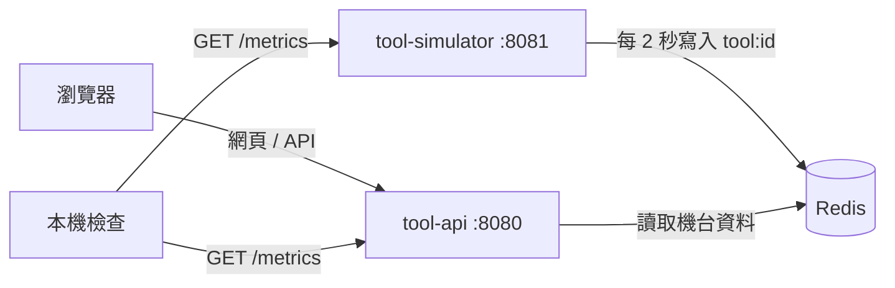

# fab-monitor

本機執行的晶圓廠機台監控練習：12 台模擬機台每兩秒更新狀態，透過 Redis 交換資料，FastAPI 提供 API、metrics 與靜態看板。



Phase 1 已由使用者驗收；**Phase 2 的 D3 叢集建立、D4 應用部署與副本實驗已由使用者回報完成，D5 尚未開始**。API 的 `/api/whoami` 在 Compose 階段顯示 `compose-api`，Kubernetes 部署後則由 Downward API 回報真實 Pod 與節點名稱。

| Phase | 進度 |
| --- | --- |
| 1：Docker、服務、網頁、測試、Lab | 使用者已回報看板、故障恢復與 27 項測試通過 |
| 2：Kubernetes | D3 三節點 Ready；D4 部署／scale／kill-pod 已操作並還原 API 為 2 份（使用者回報）；D5 尚未開始 |
| 3：監控、SLI/SLO、告警 | 未開始 |
| 4：CI/CD | 未開始 |
| 5：GitOps（選做） | 未開始 |

環境與安裝確認：Windows 請使用 Docker Desktop 的 WSL2/Linux containers，並在 WSL2 終端機操作 Kubernetes 練習。原生 PowerShell 的 Python 指令見 [Lab](docs/labs/01-docker.md)。Phase 1 使用 Docker、Compose、GNU Make 與 Python 3.12，Phase 2 另外使用 kind 與 kubectl；Helm 可留待 Phase 3。

| 工具 | 安裝後驗證指令 | 本階段是否需要 |
| --- | --- | --- |
| Docker Desktop / Engine | `docker version`（Client、Server 都應成功） | 是 |
| Docker Compose plugin | `docker compose version` | 是 |
| GNU Make | `make --version` | 是 |
| Python 3.12 | `python3.12 --version` | 是 |
| kind | `kind version` | Phase 2 |
| kubectl | `kubectl version --client` | Phase 2 |
| Helm | `helm version --short` | Phase 3 |

在專案根目錄，以 WSL2 / Bash 執行：

```bash
python3.12 -m venv .venv
source .venv/bin/activate
python -m pip install -r requirements-dev.txt
make help
make test
docker compose -f deploy/compose/docker-compose.yml config --quiet
make build
make up
make ps
```

開啟 <http://localhost:8080>。API metrics 在 <http://localhost:8080/metrics>，模擬器 metrics 在 <http://localhost:8081/metrics>。三個容器的記憶體上限合計為 512 MiB，不含 Docker Desktop / WSL2 本身；Redis 不發佈主機埠、不持久化資料。

`make up` 會建置並等待容器 healthcheck；首批資料可能還需約兩秒才出現。`make logs` 持續顯示 log，按 Ctrl+C 只離開 log；`make down` 關閉並移除容器。可用 `make build VERSION=v1` 指定映像 tag；若改 tag，啟動也應傳相同的 `VERSION`。

完整的操作、Redis 故障與恢復驗收、chaos 練習與排錯，見 [docs/labs/01-docker.md](docs/labs/01-docker.md)。

設定由環境變數讀取：API 使用 `REDIS_URL`、`APP_VERSION`、`POD_NAME`、`NODE_NAME`、`CHAOS_ENABLED`；模擬器使用 `REDIS_URL`、`TOOL_COUNT`、`TICK_SECONDS`。Compose 明確開啟 chaos，API 程式預設關閉。chaos 僅影響 `/api/*` 資料端點，控制端點、探針、網頁與 metrics 仍可存取；每次 POST 取代整份設定，送 `{}` 清除，重啟程序也會清除。

直接與間接 Python 依賴均固定在 `requirements*.txt`，`.in` 記錄直接依賴。兩份 Dockerfile 使用 `python:3.12-slim` 系列的固定修訂版 `python:3.12.12-slim-bookworm`，Compose 使用 `redis:7.4.2-alpine`。

技術參考：[Compose 資源限制與保留](https://docs.docker.com/reference/compose-file/deploy/#resources)、[Compose 的 healthcheck 與 depends_on](https://docs.docker.com/reference/compose-file/services/#depends_on)、[FastAPI 測試](https://fastapi.tiangolo.com/tutorial/testing/)。

D3 建立本機 Kubernetes 叢集：

```bash
make down
make cluster
kubectl --context kind-fab get nodes -o wide
```

`make down` 關閉已完成驗收的 Compose 練習以節省資源，`make cluster` 建立一個管理節點和兩個工作節點，並等待全部 Ready。使用 kind v0.33.0、固定版本與 digest 的 Kubernetes v1.34.11 節點映像，對應目前使用者的 kubectl v1.34.1。此時沒有部署機台應用，30080 尚不會顯示看板。完整說明見 [Lab 02](docs/labs/02-k8s-basics.md)。需要刪除練習叢集時使用 `make cluster-down`，會刪除其中的全部工作負載。

D4 部署應用（沿用已建立的叢集）：

```bash
make build VERSION=v1
make load VERSION=v1
make deploy
make status
```

Kustomize 將資源放進 fab namespace，預設啟動 Redis 1、simulator 1、API 2，共四個應用 Pod；開啟 <http://localhost:30080> 查看機台與 Pod 分流。`make load` 先以已確認的 linux/amd64 平台匯出 .cache/kind-images.tar，再匯入 kind 節點的 containerd，以避開多平台載入時的 content digest not found 已知問題；主機 image 庫與節點 image 庫是分開的。此流程需要支援 image save --platform 的 Docker（API 1.48+）。初始宣告固定 v1，版本更新操作留待 D5。

接著開另一個終端機執行 `make watch`，再用 `make scale N=3` 修改 API 期望副本數，或 `make kill-pod` 隨機刪除一個 Running API Pod，觀察控制器補回。kill-pod 使用 WSL/Bash 的 shuf。這些指令不建立新 Node；重新 `make deploy` 會按照檔案把副本數恢復為 2。
