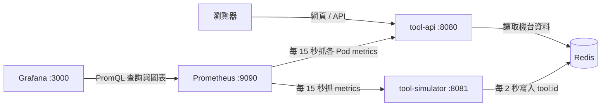

# fab-monitor

本機執行的晶圓廠機台監控練習：12 台模擬機台每兩秒更新狀態，透過 Redis 交換資料，FastAPI 提供 API、metrics 與靜態看板。



**Phase 1 到 Phase 4 的實作及操作驗收已完成，專案在此收尾。** 容器與叢集結果由使用者在 WSL 執行並回報；D7 的歷史 SLI／budget 另由代理透過本機 Prometheus 唯讀查詢核對，證據見 Lab 04。API 在 Compose 顯示 compose-api，Kubernetes 則由 Downward API 回報實際 Pod／節點名稱。

| Phase | 進度 |
| --- | --- |
| 1：Docker、服務、網頁、測試、Lab | 使用者已回報看板、故障恢復與 27 項測試通過 |
| 2：Kubernetes | 已完成：叢集、部署、擴充、自我修復、更新／回滾、探針與設定來源核對（使用者回報） |
| 3：監控、SLI/SLO、告警 | 3a／D7 完成：1200/1200 全 200／零略過、targets／圖表與短窗 SLI 驗證；3b／D8 完成：62 項測試、[SLO](docs/slo.md)、[runbook](docs/runbook.md)、錯誤率與資料新鮮度兩次告警演練 |
| 4：CI/CD | 完成：[pipeline](docs/cicd.md)、63 項測試、PR 紅 → 綠 → merge、GHCR 發佈 image，見 [Lab 05](docs/labs/05-cicd.md) |
| 5：GitOps（選做） | 不做 |

D6 紀錄與補強題見 [D6 交接](docs/notes/d6-review.md)。D7 已驗證 v3、監控安裝、三個應用 targets UP、新鮮度與十個 Grafana 面板；完整測試 57 passed，20 RPS／60 秒 1200 筆全 200、零 dropped，Grafana 操作後 89 分鐘零重啟。歷史有效樣本的可用性、300ms 延遲 SLI 及短窗 budget 剩餘均為 100%，無流量時不當成達標。完整結果與故障排查見 [Lab 04](docs/labs/04-observability-slo.md)。

D8 實測：注入 20% 錯誤後 25 秒 Pending、再 1 分鐘 Firing，清除後 5 分 06 秒解除；simulator 停止時可用性維持 100%，`ToolDataStale` 仍觸發，恢復後約 30 秒內解除。第一次演練曾遇到壓測先結束、SLI 變 NaN 而告警消失的假恢復，已記錄在 Lab 04。延遲與 Pod 不 Ready 兩條告警只確認規則載入，未實際演練。

## 已知限制與改進方向

以下只記錄設計限制與未來方向，沒有實作高可用或持久化改善。

- **Redis 是單點故障。** 兩個 API Pod 共用同一個 Redis；Redis 無法連線時，API 程序可能仍存活，但無法讀取機台資料。直接增加 Redis Deployment 的 replicas 不會建立資料同步，還可能讓請求讀到不同資料。改善方向是主從複製、Sentinel 自動切換，以及能找到目前主節點的 client；可用 StatefulSet 或合適的 Operator 管理部署，但它們本身不會自動提供 Redis 複製與切換。PV 配合 AOF／RDB 處理資料保存，不能單獨保證服務不中斷。參考 [Redis Sentinel](https://redis.io/docs/latest/operate/oss_and_stack/management/sentinel/)。
- **Simulator 目前只能單一實例。** 每個程序都管理同一組機台且在記憶體保存模擬狀態；直接增加副本會讓多個程序覆寫同一組 Redis key，產量與狀態可能互相衝突。未來若需要擴展，須先設計機台分工或單一寫入者協調，不能只改 replicas。
- **Readiness 只檢查 Redis 連線，不檢查資料新鮮度。** Simulator 停止後，只要 Redis 還有資料，API 仍可能回 200、readiness 仍通過，但 updated_at 不再前進。瀏覽器在請求失敗時保留的舊卡片也不代表 API 正常。Phase 3 將另外加入資料年齡指標、Grafana 面板與告警；這與 Redis 高可用改善是不同工作。
- **兩個 API Pod 仍有部署條件。** 副本可分攤流量與承受單一 API Pod 故障；承受節點故障的能力還取決於副本是否分散、其餘節點容量與共用依賴是否存活。maxUnavailable: 0 限制更新時主動減少可用副本的行為，不保證任何情況都完全不中斷。

## 環境與操作

環境與安裝確認：Windows 請使用 Docker Desktop 的 WSL2/Linux containers，並在 WSL2 終端機操作 Kubernetes 練習。原生 PowerShell 的 Python 指令見 [Lab](docs/labs/01-docker.md)。Phase 1 使用 Docker、Compose、GNU Make 與 Python 3.12，Phase 2 另外使用 kind 與 kubectl；Helm 可留待 Phase 3。

| 工具 | 安裝後驗證指令 | 本階段是否需要 |
| --- | --- | --- |
| Docker Desktop / Engine | `docker version`（Client、Server 都應成功） | 是 |
| Docker Compose plugin | `docker compose version` | 是 |
| GNU Make | `make --version` | 是 |
| Python 3.12 | `python3.12 --version` | 是 |
| kind | `kind version` | Phase 2 |
| kubectl | `kubectl version --client` | Phase 2 |
| Helm | `helm version --short` | Phase 3 |

在專案根目錄，以 WSL2 / Bash 執行：

```bash
python3.12 -m venv .venv
source .venv/bin/activate
python -m pip install -r requirements-dev.txt
make help
make test
docker compose -f deploy/compose/docker-compose.yml config --quiet
make build
make up
make ps
```

開啟 <http://localhost:8080>。API metrics 在 <http://localhost:8080/metrics>，模擬器 metrics 在 <http://localhost:8081/metrics>。三個容器的記憶體上限合計為 512 MiB，不含 Docker Desktop / WSL2 本身；Redis 不發佈主機埠、不持久化資料。

`make up` 會建置並等待容器 healthcheck；首批資料可能還需約兩秒才出現。`make logs` 持續顯示 log，按 Ctrl+C 只離開 log；`make down` 關閉並移除容器。可用 `make build VERSION=v1` 指定映像 tag；若改 tag，啟動也應傳相同的 `VERSION`。

完整的操作、Redis 故障與恢復驗收、chaos 練習與排錯，見 [docs/labs/01-docker.md](docs/labs/01-docker.md)。

設定由環境變數讀取：API 使用 `REDIS_URL`、`APP_VERSION`、`POD_NAME`、`NODE_NAME`、`CHAOS_ENABLED`；模擬器使用 `REDIS_URL`、`TOOL_COUNT`、`TICK_SECONDS`。Compose 明確開啟 chaos，API 程式預設關閉。chaos 僅影響 `/api/*` 資料端點，控制端點、探針、網頁與 metrics 仍可存取；每次 POST 取代整份設定，送 `{}` 清除，重啟程序也會清除。

直接與間接 Python 依賴均固定在 `requirements*.txt`，`.in` 記錄直接依賴。兩份 Dockerfile 使用 `python:3.12-slim` 系列的固定修訂版 `python:3.12.12-slim-bookworm`，Compose 使用 `redis:7.4.2-alpine`。

技術參考：[Compose 資源限制與保留](https://docs.docker.com/reference/compose-file/deploy/#resources)、[Compose 的 healthcheck 與 depends_on](https://docs.docker.com/reference/compose-file/services/#depends_on)、[FastAPI 測試](https://fastapi.tiangolo.com/tutorial/testing/)。

D3 建立本機 Kubernetes 叢集：

```bash
make down
make cluster
kubectl --context kind-fab get nodes -o wide
```

`make down` 關閉已完成驗收的 Compose 練習以節省資源，`make cluster` 建立一個管理節點和兩個工作節點，並等待全部 Ready。使用 kind v0.33.0、固定版本與 digest 的 Kubernetes v1.34.11 節點映像，對應目前使用者的 kubectl v1.34.1。此時沒有部署機台應用，30080 尚不會顯示看板。完整說明見 [Lab 02](docs/labs/02-k8s-basics.md)。需要刪除練習叢集時使用 `make cluster-down`，會刪除其中的全部工作負載。

D4 部署應用（沿用已建立的叢集）：

```bash
make build VERSION=v1
make load VERSION=v1
make deploy
make status
```

Kustomize 將資源放進 fab namespace，預設啟動 Redis 1、simulator 1、API 2，共四個應用 Pod；開啟 <http://localhost:30080> 查看機台與 Pod 分流。`make load` 先以已確認的 linux/amd64 平台匯出 .cache/kind-images.tar，再匯入 kind 節點的 containerd，以避開多平台載入時的 content digest not found 已知問題；主機 image 庫與節點 image 庫是分開的。此流程需要支援 image save --platform 的 Docker（API 1.48+）。初始宣告固定 v1，版本更新操作留待 D5。

接著開另一個終端機執行 `make watch`，再用 `make scale N=3` 修改 API 期望副本數，或 `make kill-pod` 隨機刪除一個 Running API Pod，觀察控制器補回。kill-pod 使用 WSL/Bash 的 shuf。這些指令不建立新 Node；重新 `make deploy` 會按照檔案把副本數恢復為 2。

D5 使用 `make rollout V=v2` 依序建置、載入，再以單次 Pod template 修改一起更新 API 的 image 和 APP_VERSION；`make rollback` 還原前一份模板並等待完成。Python 工具只使用標準函式庫，測試可單獨執行 `python -m unittest discover -s tools/tests -v`，也已納入 `make test`。

`make break-redis` 把 Redis 期望副本降為零，`make fix-redis` 恢復一份並等待 API 重新可用。觀察健康探針時，須區分 Service 入口和直接 Pod 的 port-forward，詳見 [Lab 03](docs/labs/03-k8s-rollout-probes.md)。使用者已回報 D5 主要操作成功，結果記錄於該 Lab。

D7 先測試，再以 `make build VERSION=v3`、`make load-images VERSION=v3`、`make deploy-observability` 更新真正新增指標的兩個服務。接著渲染固定 Helm chart、`make monitoring` 安裝；`make prometheus`／`make grafana` 分別開啟本機入口，`make load S=60 RPS=20 PYTHON=.cache/venv-wsl/bin/python` 壓測。對話中一次只跑一個步驟，完整預期與原因見 Lab 04。

注意 `make load` 的歷史命名衝突：明確傳 `S` 才跑壓測，否則保留原本 image 匯入行為；內部 rollout 工具使用 `load-images` 避免參數誤判。D7 使用獨立 overlay，舊 `make deploy` 仍會回到 v1。監控記憶體 requests 約 688 MiB、limits 約 1888 MiB，不含 app／叢集；Prometheus 資料不是永久儲存。D8 用 `kubectl --context kind-fab apply -k deploy/monitoring` 套用告警，用 `make chaos-errors`／`make chaos-latency`／`make chaos-clear` 演練。
