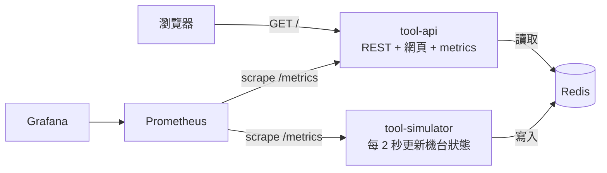

# fab-monitor 專案規格

一個迷你的「晶圓廠機台監控」微服務系統，用來在兩週內動手學會 Docker、Kubernetes、監控告警（SLI/SLO）和 CI/CD，並作為台積電 IT 面試時可以展示和講解的作品。

## 給 Claude Code 的工作規則

1. **一次只做一個 Phase。** 做完一個 Phase 後停下來，列出我要跑的驗證指令，等我確認再進下一個。不要提前實作後面 Phase 的東西。
2. **我是學習者。** 所有設定檔（Dockerfile、K8s YAML、Helm values、CI workflow）都要有簡短的中文註解，說明「這行為什麼要這樣寫」，不是只說它做什麼。
3. **每個 Phase 都要產出一份 lab 文件**（`docs/labs/0N-*.md`，格式見最後一節），我會照著自己一步一步跑指令。
4. **全部在本機跑**，不需要雲端帳號。資源要省：每個 container 都設 `resources.requests/limits`，整套系統（含監控）在 8GB RAM 的筆電能跑。
5. **所有版本都要固定**（base image、Python 套件、Helm chart、GitHub Actions），不要用 `latest`。
6. 每個 Phase 完成時，`make help` 要列出這個 Phase 新增的指令。
7. 不要加入規格沒提到的技術或功能。不確定的地方先問我。

## 系統架構



### 服務一：tool-simulator

- Python 3.12，模擬 `TOOL_COUNT` 台機台（預設 12），每 `TICK_SECONDS` 秒（預設 2）更新一次，寫入 Redis hash `tool:<id>`
- 機台 id 格式：`ETCH-01`、`CVD-02`、`PHOTO-03`、`CMP-04`、`IMP-05`……依序輪替這五種類型
- 每台欄位：`id`、`type`、`status`（`RUN` / `IDLE` / `DOWN`）、`temperature_c`（浮點數）、`wafer_count`（RUN 時遞增）、`updated_at`（ISO 8601）
- 狀態轉移用簡單的機率：RUN 有 3% 變 DOWN，DOWN 有 20% 恢復成 IDLE，IDLE 有 30% 變 RUN
- 開一個 port 8081 提供 `/metrics`：`simulator_ticks_total`、`simulator_tools{status="RUN|IDLE|DOWN"}`；Phase 3a 加入 `simulator_last_tick_timestamp_seconds`，記錄最近一次成功寫入 Redis 的 tick 完成時間（Unix 秒數），寫入失敗不前進

### 服務二：tool-api

- Python 3.12 + FastAPI + uvicorn + `prometheus_client`，port 8080
- 端點：

| 方法 | 路徑 | 用途 |
|---|---|---|
| GET | `/health` | liveness，永遠回 `{"status":"ok"}` |
| GET | `/ready` | readiness，Redis 連得到才回 200，否則 503 |
| GET | `/api/tools` | 所有機台列表，支援 `?status=DOWN` 篩選 |
| GET | `/api/tools/{id}` | 單一機台，不存在回 404 |
| GET | `/api/whoami` | 回傳 `pod_name`、`node_name`、`version`（從環境變數讀） |
| POST | `/api/chaos` | 注入故障：`{"latency_ms": 500, "error_rate": 0.2}`，`{}` 代表清除。只有 `CHAOS_ENABLED=true` 時可用，否則回 403 |
| GET | `/metrics` | Prometheus metrics |
| GET | `/` | 可視化網頁（見下方） |

- Metrics：
  - `http_requests_total{route, method, code}`（route 用路由樣板如 `/api/tools/{id}`，不要用實際 id，避免 label 爆量）
  - `http_request_duration_seconds{route}` histogram，buckets 要包含 0.1、0.3、0.5、1
  - `tool_api_info{version, pod}` gauge = 1
  - Phase 3a 加入 `tool_data_age_seconds` gauge：每次抓取 `/metrics` 時，以 Redis 所有機台的 `updated_at` 計算資料年齡最大值（秒），不得依賴使用者先呼叫 `/api/tools` 才更新
- 設定全部從環境變數讀：`REDIS_URL`、`APP_VERSION`、`POD_NAME`、`NODE_NAME`、`CHAOS_ENABLED`
- 用 `pytest` + `fakeredis` 寫測試，至少涵蓋每個 API 端點和 chaos 的開關

### 可視化網頁（tool-api 的 `/`）

單一靜態 HTML，不用前端框架，由 tool-api 直接回傳。目的是讓我**用眼睛看到** K8s 在做什麼：

1. **機台看板**：每 2 秒抓 `/api/tools`，用卡片格狀顯示每台機台，依狀態上色（RUN 綠、IDLE 灰、DOWN 紅），顯示溫度和 wafer 數，上方顯示三種狀態的數量
2. **「這次請求由哪個 Pod 處理」面板**：每 1 秒打一次 `/api/whoami`，顯示最近 30 次結果的 pod 名稱長條，每個 pod 一個顏色，並統計每個 pod 被分到的次數。scale 成 3 個 replica 時，應該看得到流量被分散；滾動更新時，應該看得到舊版本的 pod 逐漸被新版本取代
3. **版本標籤**：頁面右上角顯示目前收到的 `version`，滾動更新期間會在新舊之間跳動
4. **Chaos 控制區**：三個按鈕「加 500ms 延遲」、「20% 錯誤率」、「清除」，呼叫 `/api/chaos`，並顯示最近 30 次請求的延遲和成功/失敗
5. 請求失敗時不要整頁壞掉，在對應區塊顯示錯誤

## Phase 1：Docker（對應 Day 2 晚上）

- 兩個服務各一個 `Dockerfile`：用 `python:3.12-slim`，先 COPY requirements 再 COPY 程式碼（利用 layer cache），用非 root 使用者執行，加 `HEALTHCHECK`
- `.dockerignore`
- `deploy/compose/docker-compose.yml`：redis + tool-simulator + tool-api，tool-api 開 `CHAOS_ENABLED=true`，用 `depends_on` + healthcheck 確保 Redis 先起來
- Makefile 指令：

| 指令 | 做什麼 |
|---|---|
| `make build` | build 兩個 image，tag 為 `fab/tool-api:<VERSION>`、`fab/tool-simulator:<VERSION>`，VERSION 預設 `v1` |
| `make up` / `make down` | 用 compose 啟動 / 關閉 |
| `make logs` | 看所有服務 log |
| `make test` | 在本機跑 pytest |
| `make ps` | 看 container 狀態 |

- **驗收**：`make up` 後打開 `http://localhost:8080` 看到 12 台機台在變化；`docker compose stop redis` 後 `/ready` 變 503，網頁顯示錯誤但不當掉
- Lab 文件：`docs/labs/01-docker.md`

## Phase 2：Kubernetes（對應 Day 3–5 晚上）

- 用 **kind** 建本機叢集，`deploy/kind/kind-config.yaml`：1 個 control-plane + 2 個 worker，並把 host 的 30080 對應到 NodePort
- `deploy/k8s/` 用 **Kustomize** 組織，namespace 為 `fab`：
  - Redis：Deployment + Service（不用持久化，學習用）
  - tool-simulator：Deployment（1 replica）+ Service（給 metrics 用）
  - tool-api：Deployment（預設 2 replica）+ NodePort Service（30080）+ ConfigMap（放 `REDIS_URL`、`CHAOS_ENABLED`）
  - tool-api 用 **Downward API** 把 pod 名稱和 node 名稱注入成 `POD_NAME`、`NODE_NAME`
  - tool-api 設定 `livenessProbe`（`/health`）、`readinessProbe`（`/ready`）、`resources`、滾動更新策略 `maxUnavailable: 0`、`maxSurge: 1`
  - 加上 **topologySpreadConstraints** 讓 tool-api 的 pod 盡量分散在不同 worker
- Makefile 指令：

| 指令 | 做什麼 |
|---|---|
| `make cluster` / `make cluster-down` | 建立 / 刪除 kind 叢集 |
| `make load` | 把本機 image 載入 kind（`kind load docker-image`） |
| `make deploy` | `kubectl apply -k deploy/k8s` |
| `make status` | 一次列出 `fab` namespace 的 pods（含所在 node）、services、deployments |
| `make watch` | `kubectl get pods -n fab -o wide -w`，開另一個終端機邊操作邊看 |
| `make scale N=3` | 調整 tool-api replica 數 |
| `make rollout V=v2` | build + load 新版本 image，更新 Deployment，並跟著 `rollout status` |
| `make rollback` | `kubectl rollout undo` |
| `make kill-pod` | 隨機刪掉一個 tool-api pod，觀察自我修復 |
| `make break-redis` / `make fix-redis` | 把 Redis scale 到 0 / 1，觀察 readiness 讓 pod 被移出 Service |

- **驗收**：
  - 打開 `http://localhost:30080`，`make scale N=3` 後網頁的 Pod 面板出現 3 種顏色
  - `make rollout V=v2` 期間網頁版本標籤在 v1、v2 之間跳動，最後全是 v2，且沒有請求失敗
  - `make kill-pod` 後幾秒內出現新 pod
- Lab 文件：`docs/labs/02-k8s-basics.md`（建叢集、部署、scale、kill-pod）、`docs/labs/03-k8s-rollout-probes.md`（滾動更新、回滾、probe）
- 在 lab 裡建議我安裝 **k9s** 當作終端機版的叢集可視化工具，並說明基本操作

## Phase 3：監控、SLI/SLO、告警（對應 Day 7–8）

### 執行順序（2026-10-28 使用者核准修訂）

本 Phase 拆成兩個階段，每次帶學習者執行一個步驟，確認結果後才接下一步。

1. **Phase 3a／D7**：先確認既有 kind fab 叢集、三個 Ready 節點、fab namespace 的 API 兩個 v1 Pod、Redis 與 simulator 各一個 Pod，以及 localhost:30080/ready 回 200；接著安裝 kube-prometheus-stack、ServiceMonitor、loadgen、Grafana dashboard，加入下述兩個新鮮度指標與對應 pytest。D7 dashboard 先以原始 metrics 的 PromQL 計算請求、延遲、SLI、budget 與資料新鮮度，不得依賴尚未建立的 recording rules。**D7 驗收後停下，等使用者確認再進 D8。**
2. **Phase 3b／D8**：才建立 docs/slo.md、recording rules、PrometheusRule 告警、docs/runbook.md 與 chaos／資料停更故障驗收。D7 不提前建立告警或執行 D8 的故障演練。

以下為兩階段合計的交付範圍；Lab 04 須明確分開 D7 與 D8，保留中間停止點。重開機後先診斷現況，已有可用叢集就沿用，不直接刪除重建。

- 用 Helm 安裝 **kube-prometheus-stack**（固定 chart 版本），values 放在 `deploy/monitoring/values.yaml`，關掉這個專案用不到的元件以省資源
- `ServiceMonitor` 讓 Prometheus 抓 tool-api 和 tool-simulator 的 `/metrics`
- 小型壓測工具：`tools/loadgen.py`，用 asyncio 以固定 RPS（預設 20）打 `/api/tools`，可指定秒數
- **SLI/SLO 定義**寫在 `docs/slo.md`：

| SLI | 定義 | SLO |
|---|---|---|
| 可用性 | `/api/*` 非 5xx 的請求比例 | 99% |
| 延遲 | `/api/*` 在 300ms 內完成的請求比例 | 95% |

  文件要說明：SLI / SLO / SLA 的差別、error budget 是什麼、以 30 天計算 99% 等於可以壞多久，以及這個 lab 為了方便觀察，告警用短時間窗
  - 另說明「HTTP 200」只表示請求成功，不能證明機台資料仍新鮮；資料新鮮度須獨立監控，不把 30 秒告警門檻直接當成新的 30 天 SLO 承諾
- `PrometheusRule`：
  - recording rules 算出兩個 SLI
  - 告警：可用性在 5 分鐘窗低於 99% 觸發 `ToolApiHighErrorRate`；延遲 SLI 在 5 分鐘窗低於 95% 觸發 `ToolApiSlowResponses`；有 tool-api pod 不 ready 超過 2 分鐘觸發 `ToolApiPodNotReady`
  - 新增 `ToolDataStale`：所有 API 副本中觀察到的最大 `tool_data_age_seconds` 超過 30 秒且連續持續 2 分鐘（`for: 2m`）觸發，避免每個 API 副本重複發出同一份共享資料的告警；附 docs/runbook.md 對應段落
  - 每條告警都要有 `summary`、`description` 和 `runbook`（指向 `docs/runbook.md` 對應段落）
- **Grafana dashboard**（JSON 放在 repo，用 ConfigMap 自動匯入）：
  - 每秒請求數（依 code 分）、錯誤率、p50/p95/p99 延遲
  - 兩個 SLI 的目前值和 SLO 目標線
  - error budget 剩餘比例
  - 每個 pod 的請求分佈
  - 機台狀態數量（來自 simulator）
  - 資料新鮮度：以秒顯示最舊機台資料年齡、30 秒門檻，並能查詢 `time() - simulator_last_tick_timestamp_seconds` 協助定位寫入停滯；沒有資料不能顯示為健康的 0 秒
- `docs/runbook.md`：每條告警的可能原因、怎麼查（具體的 kubectl / PromQL 指令）、怎麼處理
- **資料新鮮度實作與測試（使用者新增範圍）**：
  - tool-api 的 `tool_data_age_seconds` 是 `max(0, 現在 UTC 時間 - 每台 updated_at)` 的最大值，計算涵蓋全部機台，不受 status 篩選或 API 流量影響；simulator 停止後該值必須隨每次 scrape 增加
  - Redis 讀取失敗、機台集合為空或時間資料無效時，必須明確表達未知／無資料，不能假裝 0 秒或繼續輸出上次成功的健康值；保留其他 HTTP metrics 可觀測，並在 Lab 說明該狀態與資料過期的差別
  - simulator 的 `simulator_last_tick_timestamp_seconds` 只有整批寫入成功後才更新；程序停止時 target 消失，不可把消失誤讀成最近仍有 tick
  - pytest 至少涵蓋多台取最舊時間、停止寫入後年齡增加、未來時間不產生負數、空資料／Redis 錯誤／無效時間的行為，以及 simulator 成功 tick 更新時間、失敗不更新；測試以可控制時間驗證，不靠長時間 sleep
- Makefile 指令：

| 指令 | 做什麼 |
|---|---|
| `make monitoring` | 安裝監控 |
| `make grafana` / `make prometheus` | port-forward 並印出網址和帳密 |
| `make load S=300` | 跑壓測 S 秒 |
| `make chaos-latency` / `make chaos-errors` / `make chaos-clear` | 透過 API 對所有 tool-api pod 注入或清除故障 |

- D7 加入 monitoring、grafana、prometheus、load；D8 才加入 chaos 指令，並各自在 make help 顯示。
- `load` 與 Phase 2 的舊 target 同名：明確傳 `S` 才跑壓測；不傳 `S` 保留舊映像匯入行為，新增無歧義的 `make load-images VERSION=v3` 供 D7 與內部工具使用。D7 以新的 v3 tag 加 observability overlay 更新兩個服務，不覆寫既有 v1 base 的教學基準，新增 `make deploy-observability` 套用。
- **驗收**：跑壓測時 `make chaos-errors`，Grafana 上錯誤率上升、error budget 下降，5 分鐘內 Prometheus 的 Alerts 頁面出現 `ToolApiHighErrorRate`；`make chaos-clear` 後恢復
- **D8 資料新鮮度驗收**：把 simulator scale 到 0 → Redis 與 API 保持正常、確認 `/api/tools` 仍回 200 但 updated_at 不再前進 → 觀察資料年齡超過 30 秒並持續 2 分鐘後 `ToolDataStale` 觸發 → scale 回 1 → 成功寫入後資料年齡下降、告警解除。Lab 必須記錄實際觸發與解除結果，不能只以 YAML 存在判定驗收成功
- Lab 文件：`docs/labs/04-observability-slo.md`

## Phase 4：CI/CD（對應 Day 9）

- `.github/workflows/ci.yml`，在 push 和 PR 時執行：
  1. `ruff` lint
  2. `pytest`
  3. build 兩個 image
  4. 只有 push 到 `main` 時才 push 到 GHCR，tag 用 git short SHA 和 `latest-main`
- PR 上 lint 或測試失敗時，workflow 要失敗
- `docs/cicd.md`：用一張 mermaid 圖畫出 pipeline 各階段，並說明為什麼測試要放在 build 之前、image tag 為什麼用 SHA
- **驗收**：故意寫一個會失敗的測試發 PR，看到 CI 變紅；修好後變綠，merge 後 GHCR 出現新 image
- Lab 文件：`docs/labs/05-cicd.md`

## Phase 5（選做）：GitOps with ArgoCD

- 在 kind 安裝 ArgoCD，建立一個 `Application` 指向這個 repo 的 `deploy/k8s`
- **驗收**：只在 Git 改 replica 數並 push，ArgoCD 自動同步，叢集 pod 數跟著變；手動 `kubectl scale` 後 ArgoCD 會把它改回 Git 的狀態
- Lab 文件：`docs/labs/06-gitops-argocd.md`，說明 push-based CD 和 GitOps 的差別

## Repo 結構

```
fab-monitor/
├── README.md               # 專案介紹、架構圖、快速開始、各 Phase 進度
├── SPEC.md                 # 本文件
├── Makefile
├── services/
│   ├── tool-api/           # app/、tests/、Dockerfile、requirements.txt
│   └── tool-simulator/
├── deploy/
│   ├── compose/
│   ├── kind/
│   ├── k8s/
│   └── monitoring/
├── tools/loadgen.py
├── .github/workflows/ci.yml
└── docs/
    ├── labs/
    ├── slo.md
    ├── runbook.md
    └── cicd.md
```

## Lab 文件格式

每份 lab 都照這個結構寫，給我自己一步一步跑：

1. **目標**：做完會懂什麼（2–3 點）
2. **架構圖**：這個 Phase 的 mermaid 圖，標出新增的部分
3. **步驟**：每一步包含
   - 要跑的指令
   - **你應該看到**：預期輸出或網頁上的變化
   - **剛剛發生了什麼**：2–3 句解釋背後的機制
4. **自己動手改**：1–2 個小練習，由我自己寫，不要提供答案（例如：幫 `/api/tools` 加一個 `?type=ETCH` 篩選，並補上測試）
5. **面試自問**：3–5 題這個主題的常見面試題，只列題目，我自己用中文回答後寫在文件最後
6. **常見錯誤排查**：2–3 個最可能遇到的錯誤和解法

## 環境需求

- Docker Desktop（Windows 請用 WSL2）、kind、kubectl、Helm、make、Python 3.12
- README 要列出每個工具的安裝驗證指令（例如 `kind version`）
