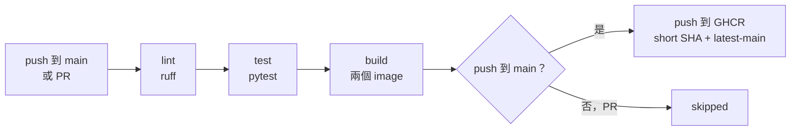

# fab-monitor CI/CD

每次 push 到 `main` 或開 PR，GitHub Actions 就會自動檢查。只有進到 `main` 的程式才會發佈 image。Workflow 在 `.github/workflows/ci.yml`。

這份 repo 只做 CI 和發佈 image，沒有自動部署到叢集。

## Pipeline

任何一步失敗，後面的 job 都不會執行。

| Job | 做什麼 | 什麼時候跑 |
|---|---|---|
| `lint` | `make lint` | 每次 |
| `test` | `make test` | lint 通過後 |
| `build` | 用 matrix 建兩個 image，存成 artifact | test 通過後 |
| `push` | 載入同一份 image，推到 GHCR | build 通過，且是 push 到 `main` |

## 為什麼測試要在 build 之前

Build 一個測試沒過的 image 沒有用。測試比 build 便宜，放前面就能盡快失敗，不浪費時間和運算資源。實測時 PR 測試失敗，`build` 和 `push` 都是 skipped。

## 為什麼 image tag 用 SHA

`latest-main` 每次都會被覆蓋，無法分辨線上跑的是哪一版，舊版也找不回來。

Short SHA（例如 `065f61d`）對應到確切的 commit，出事時可以查出當時的程式碼，rollback 時也能指定確切版本。`latest-main` 只是方便人看。

## 為什麼 push 不重新 build

Build job 把 image 存成 artifact，push job 載入後直接推送。如果重新 build，推上去的就不是剛才驗證過的那一份。

## 不存長期金鑰

Push 到 GHCR 用 GitHub 自動發放的 `GITHUB_TOKEN`，它在每次 run 開始時產生，結束後失效，所以 repo 裡沒有任何長期密碼。

權限也限到最小：workflow 預設只有 `contents: read`，只有 `push` job 宣告 `packages: write`。

### 和 BikeFlow 的比較

| | BikeFlow | fab-monitor |
|---|---|---|
| 目標 | 部署到 AWS | 推 image 到 GHCR |
| 怎麼取得權限 | OIDC 換短期憑證 | GitHub 自動發的 `GITHUB_TOKEN` |
| repo 要存長期金鑰嗎 | 不用 | 不用 |

兩者都用短期憑證取代長期金鑰，金鑰外洩的風險因此降低。差別在於 AWS 是 GitHub 以外的服務，要靠 OIDC 建立信任；GHCR 是 GitHub 自己的服務，直接用 `GITHUB_TOKEN`。

## 版本固定

- Python 用 `3.12.12`，與 Dockerfile 相同
- 依賴照 `requirements-dev.txt`，ruff 固定在 0.15.10
- 第三方 Action 鎖完整 commit SHA，因為 tag 可以被移動，SHA 不行

## 第一次 run 遇到的問題

`push (tool-api)` 卡在上傳 layer 超過 10 分鐘，同一時間 `tool-simulator` 16 秒就成功。取消後讀 log，登入成功、部分 layer 已推上去，有一個重試過，之後就停住，不是權限問題。

處理方式：

- `timeout-minutes: 10`：卡住時盡快失敗，而不是等預設的 6 小時
- `max-parallel: 1`：兩個 image 共用 Python base layer，改成一次推一個

修正後 `tool-api` 18 秒推完，之後的 run 也成功。**同時推送是否為根因沒有被證實**，只知道改成序列後沒有再發生。
