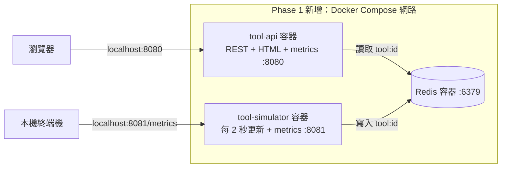

# Lab 01：用 Docker 跑起晶圓廠機台監控

## 1. 目標

- 理解 image 與 container 的差別，實際操作建置、啟動、log 與清理。
- 理解 Compose 的服務名稱解析、啟動順序、healthcheck 與資源限制。
- 觀察 Redis 中斷時，liveness 與 readiness 的差別，並確認網頁能顯示錯誤後恢復。

本 Lab 只做 Phase 1。完成驗收後停下，不建立叢集或執行後續 Phase。

## 2. 架構圖



三個容器都有資源保留與限制。Compose 寫法為 `deploy.resources.reservations/limits`，其中 reservations 是資源保留設定，並非 Kubernetes 的 `requests` 或排程保證；本機仍須有足夠可用資源。記憶體上限分別為 Redis 128 MiB、simulator 128 MiB、API 256 MiB。

## 3. 步驟

以下每一步都在含有 `SPEC.md` 的專案根目錄執行。主要範例使用 WSL2 / Bash；不要把 PowerShell 的虛擬環境和 WSL 的虛擬環境混用。若切換作業系統，重新建立 `.venv`。

### 步驟 1：確認環境

先啟動 Docker Desktop，確認使用 Linux containers，並在設定中開啟 WSL2 與目前發行版的整合。

```bash
docker version
docker compose version
make --version
python3.12 --version
```

**你應該看到**：Docker 同時有 Client 與 Server；Compose 有版本資訊；GNU Make 可執行；Python 顯示 3.12.x。

**剛剛發生了什麼**：Docker CLI 只是用戶端，必須連得到 Docker Engine 才能建置與啟動容器。WSL2 提供 Linux 執行環境，Python 3.12 則用於本機測試。

### 步驟 2：建立測試環境

WSL2 / Bash：

```bash
python3.12 -m venv .venv
source .venv/bin/activate
python -m pip install -r requirements-dev.txt
make help
make test
```

若使用原生 PowerShell，改用以下指令，不需要啟用虛擬環境：

```powershell
python3.12 -m venv .venv
.\.venv\Scripts\python.exe -m pip install -r requirements-dev.txt
make help
make test PYTHON=.venv/Scripts/python.exe
```

若已透過 Windows Python Launcher 安裝 3.12，也可以用 `py -3.12` 取代建立環境時的 `python3.12`。

**你應該看到**：套件成功安裝；help 只列出 Phase 1 的 `build`、`up`、`down`、`logs`、`test`、`ps`；pytest 沒有失敗。

**剛剛發生了什麼**：測試使用 fakeredis 模擬 Redis，不需要先啟動真正的 Redis。測試涵蓋 API 端點、chaos、Redis 故障與恢復、狀態轉移與 metrics；它們不能取代 Docker 網路與瀏覽器驗收。

### 步驟 3：檢查設定與建置映像

```bash
docker compose -f deploy/compose/docker-compose.yml config --quiet
make build
docker image ls fab/tool-api
docker image ls fab/tool-simulator
```

**你應該看到**：`config --quiet` 沒有錯誤且沒有輸出；兩個 image 都有 `v1` tag。第一次建置需要下載 base image 與套件，較慢。

**剛剛發生了什麼**：Dockerfile 先複製 requirements 並安裝，再複製程式；修改程式時可沿用依賴層快取。`.dockerignore` 避免把虛擬環境、測試與文件送入建置；程式最後以 UID 10001 執行。

### 步驟 4：啟動並觀察看板

```bash
make up
make ps
docker compose -f deploy/compose/docker-compose.yml exec tool-api id
```

開啟 <http://localhost:8080>，觀察至少 20 秒。在另一個終端機查看 log：

```bash
make logs
```

**你應該看到**：三個容器為 running / healthy，`id` 顯示 `uid=10001(app)`。看板出現 12 台機台、RUN 綠色 / IDLE 灰色 / DOWN 紅色、溫度與 wafer 數；RUN 機台的 wafer 數遞增。Pod 面板持續出現 `compose-api`，版本為 `v1`；因為狀態轉移是隨機事件，不保證 20 秒內三種狀態都會出現。

**剛剛發生了什麼**：Compose 等 Redis 的 `PING` 通過才啟動兩個服務。服務透過網路內的 `redis` 名稱連線，不能用容器內的 `localhost` 指向另一個容器；此時只有一個 API 容器，所以 Pod 色條只有一種顏色。Ctrl+C 只停止看 log，不會關閉容器。

### 步驟 5：檢查 API 與 metrics

以下使用 `curl`；在原生 PowerShell 請改用 `curl.exe`，以免呼叫到舊版 PowerShell 的別名。

```bash
curl -i http://localhost:8080/health
curl -i http://localhost:8080/ready
curl -s http://localhost:8080/api/tools
curl -s 'http://localhost:8080/api/tools?status=DOWN'
curl -i http://localhost:8080/api/tools/ETCH-01
curl -i http://localhost:8080/api/tools/missing
curl -s http://localhost:8080/api/whoami
curl -s http://localhost:8080/metrics
curl -s http://localhost:8081/metrics
docker compose -f deploy/compose/docker-compose.yml exec redis redis-cli HGETALL tool:ETCH-01
```

**你應該看到**：`/health`、`/ready` 是 200，前者回 `{"status":"ok"}`；所有機台為 JSON 陣列，`status=DOWN` 只留下 DOWN（可能為空陣列）。`ETCH-01` 回 200，不存在的 ID 回 404，whoami 回名稱、節點及版本。API metrics 有 `http_requests_total`、`http_request_duration_seconds_bucket`、`tool_api_info`；simulator 有持續遞增的 `simulator_ticks_total` 與三個狀態的 `simulator_tools`。Redis hash 有六個規格欄位。

**剛剛發生了什麼**：Redis hash 儲存的是字串，API 回傳時把溫度與 wafer 數轉為數字。metrics 使用 `/api/tools/{id}` 路由樣板，避免每台機台都建立不同的路由 label；目前只是提供 metrics，沒有部署監控系統。

### 步驟 6：體驗 chaos 並清除

在網頁依序操作，每次觀察 15–30 秒：

1. 按「加 500ms 延遲」，看請求色條變高。
2. 按「20% 錯誤率」，看部分請求變紅且對應區塊出現錯誤。
3. 按「清除」，確認請求恢復。

也可在 Bash 直接執行：

```bash
curl -s -X POST http://localhost:8080/api/chaos -H 'Content-Type: application/json' -d '{"latency_ms":500,"error_rate":0.2}'
curl -s -X POST http://localhost:8080/api/chaos -H 'Content-Type: application/json' -d '{}'
```

PowerShell 的替代方式：

```powershell
Invoke-RestMethod -Method Post -Uri http://localhost:8080/api/chaos -ContentType 'application/json' -Body '{"latency_ms":500,"error_rate":0.2}'
Invoke-RestMethod -Method Post -Uri http://localhost:8080/api/chaos -ContentType 'application/json' -Body '{}'
```

**你應該看到**：延遲約增加 500ms；20% 是每次獨立的隨機機率，短時間不保證剛好五次有一次錯誤。清除後設定回到零，網頁仍可正常操作。

**剛剛發生了什麼**：POST 每次取代整份 chaos 設定，所以按錯誤率按鈕也會清除先前延遲。注入只影響 API 資料請求，控制端點與健康探針不受影響，才能在故障期間清除設定；`CHAOS_ENABLED` 程式預設為 false，Compose 才明確開啟。

### 步驟 7：停止 Redis，驗收故障與恢復

先確認上一步已按「清除」，保持網頁開啟：

```bash
docker compose -f deploy/compose/docker-compose.yml stop redis
curl -i http://localhost:8080/ready
curl -i http://localhost:8080/health
curl -i http://localhost:8080/api/tools
make ps
```

**你應該看到**：`/ready` 與 `/api/tools` 回 503，`/health` 仍回 200。約幾秒內，機台區塊顯示讀取失敗並保留上次資料，整頁仍可操作；whoami 與版本區塊持續更新。API 容器的 Docker healthcheck 仍可能顯示 healthy，這是因為它檢查 `/health`。

**剛剛發生了什麼**：liveness 判斷程序能否回應，readiness 判斷依賴是否可用。`depends_on` 只在啟動時協調順序，不會在 Redis 停止後自動替 API 修復依賴；API 使用連線逾時回報錯誤，模擬器則在下次 tick 重試。

恢復 Redis：

```bash
docker compose -f deploy/compose/docker-compose.yml start redis
curl -i http://localhost:8080/ready
```

**你應該看到**：Redis 啟動後 readiness 回 200；若仍是 503，稍候兩秒再查。看板會自動恢復更新，無須重建或重啟 API / simulator。

**剛剛發生了什麼**：Redis client 重新建立連線，模擬器再次寫入資料，網頁輪詢成功後清除區塊錯誤。Redis 未啟用持久化；整組容器重建後 wafer 累計會重新開始，不應把這份練習資料當作永久紀錄。

注意：規格中的 `docker compose stop redis` 在這個 repo 必須帶 `-f deploy/compose/docker-compose.yml`，因為 Compose 檔不在根目錄。

### 步驟 8：關閉並確認資源釋放

```bash
make down
make ps
```

**你應該看到**：服務容器與專案網路被移除，`make ps` 不再列出執行中的服務；建好的 image 仍保留。

**剛剛發生了什麼**：`down` 移除 container 與網路，image 可供下次重用。重新執行 `make up` 會建立新容器並重新開始模擬。

## 4. 自己動手改

1. 為 `/api/tools` 加上 `?type=ETCH` 篩選，允許與 `status` 一起使用，並補上測試。
2. 把 Compose 的機台數改成 5，重新建立 simulator，觀察 Redis 舊的 `tool:*` 是否仍存在；思考如何讓「減少機台數」後的資料保持一致，再自行實作處理方式。

不提供實作答案。第二題操作前先 `make down` 再 `make up` 可回到乾淨的起點；要觀察殘留資料時，則在已有 12 台資料後只重建 simulator。

## 5. 面試自問

1. Image 與 container 有什麼差別？為什麼修改 Python 程式後需要重建映像？
2. 為什麼 Dockerfile 先 COPY requirements，再 COPY 程式碼？什麼變更會使依賴層快取失效？
3. 為什麼 API 容器連 Redis 要使用 `redis:6379`，不是 `localhost:6379`？
4. `/health` 和 `/ready` 為什麼應分開？Redis 中斷時各自應回什麼？
5. `depends_on: condition: service_healthy` 能解決什麼問題？它不能保證哪些執行期間的行為？

## 6. 常見錯誤排查

### Docker daemon 連不上，或 WSL 找不到 Docker

重新確認 Docker Desktop 已開啟、使用 Linux containers，且設定中的 WSL integration 已對目前發行版開啟。執行 `docker version`，先讓 Server 區段能正常顯示，再重跑 `make up`。若建置下載失敗，檢查 Docker Desktop 的網路與代理設定，不要把網路錯誤誤認成 Dockerfile 語法問題。

### 8080 / 8081 已被占用，或啟動後看不到頁面

先用 `make ps` 與 `make logs` 確認是哪個服務失敗，再停止占用該埠的舊程序／容器，或自行調整 Compose 對主機的埠。若頁面可開但機台空白，先等一個 tick，再檢查 simulator log 與 `/ready`；Redis 必須為 healthy。

### `make test` 找不到 pytest，或找不到 Make / Python 3.12

確認測試使用剛安裝依賴的虛擬環境：Bash 重新 `source .venv/bin/activate`，PowerShell 使用 `make test PYTHON=.venv/Scripts/python.exe`。`python --version` 必須是 3.12.x；套件安裝失敗時先處理網路／代理與版本問題。Make 在 WSL2 可安裝 GNU Make，並用 `make --version` 確認終端機能找到它。

---

**驗收紀錄（自己填寫）**

- 日期與執行環境：
- `make test` 結果：
- 三個容器健康狀態：
- 12 台機台更新觀察：
- Redis 停止後 `/ready` / `/health` 狀態碼：
- Redis 恢復後網頁是否自動恢復：
- 面試題中文回答：

技術參考：[Compose 的 depends_on](https://docs.docker.com/reference/compose-file/services/#depends_on)、[Compose 資源設定](https://docs.docker.com/reference/compose-file/deploy/#resources)。

## 7. 延伸觀念

依目前學習安排，D2（10/24）先掌握 Dockerfile、build、run、layer 快取與啟動看板；D3 再完成 Compose 網路、healthcheck 與 Redis 故障驗收。以下先補 D2 基礎，再提供面試補充，不需要現在一次執行所有實驗。是否開始 Phase 2，仍等你明確確認。

### 7.1 D2 基礎：Dockerfile、image、container 各是什麼？

目前是一個模擬器程式管理 12 筆機台資料，共有 simulator、Redis、API 三個服務容器。12 台模擬機台不是 12 個容器。

```text
Dockerfile + 程式碼 + requirements
              │ docker build
              ↓
            image（映像：程式與執行環境的範本）
              │ docker run，或由 Compose 建立並啟動
              ↓
          container（容器：依映像建立的執行實例）
```

一個 image 可以建立多個 container。建好 image 不代表服務已經啟動，container 存在也不代表主程序仍在執行。容器通常有自己的程序、檔案系統與網路隔離，不是各自啟動一套完整作業系統；Docker Desktop 會透過 Linux 環境執行這裡的 Linux 容器。

以 `services/tool-api/Dockerfile` 為例：

| 指令 | 本專案的作用與原因 | 發生時間 |
| --- | --- | --- |
| `FROM python:3.12.12-slim-bookworm` | 從含 Python 的固定修訂版基底開始，不必從空白環境安裝 Python | build |
| `WORKDIR /app` | 設定後續指令的工作目錄，讓程式路徑一致 | 設定在 build 時寫入，執行時也沿用 |
| `COPY ...requirements.txt ...` | 先放入較少變動的依賴清單，便於重用安裝快取 | build |
| `RUN pip install ...` | 把套件安裝進 image，不是每次開容器都重新安裝 | build |
| `COPY ...app ./app` | 將原始碼放進 image；改主機檔案不會自動改到既有 image | build |
| `USER app` | 指定後續指令與容器預設使用非 root 帳號 | 設定在 build 時寫入，執行時也沿用 |
| `EXPOSE 8080` | 宣告應用使用的埠，不會自行把埠公開到主機 | build 時記錄中繼資料 |
| `HEALTHCHECK ...` | 告訴 Docker 如何定期檢查容器裡的服務 | run |
| `CMD ["uvicorn", ...]` | 記錄容器啟動時預設執行的命令，不會在 build 時啟動伺服器 | run |

自己讀一次 Dockerfile：

```bash
cat services/tool-api/Dockerfile
```

**指令與預期**：`cat` 只顯示檔案內容，不會建置或啟動任何服務。對照上表，先找出哪些指令準備環境、哪些設定留到容器啟動時使用。

直接建置 API image 的等價示例：

```bash
docker build -f services/tool-api/Dockerfile -t fab/tool-api:v1 .
```

**指令拆解**：`-f` 指定 Dockerfile；`-t` 指定映像名稱與 tag；最後的 `.` 是 build context，代表以目前專案根目錄提供建置所需檔案，所以請在根目錄執行。Dockerfile 中 `COPY` 的來源路徑相對於 context，而非相對於 Dockerfile 所在資料夾；`.dockerignore` 會排除不需要的內容。

**預期結果**：出現建置步驟，成功後得到 `fab/tool-api:v1`。這一步不會啟動 API；本專案的 `make build` 則透過 Compose 一次建置 API 與 simulator。

再建立一個只執行短命令的臨時容器：

```bash
docker run --rm fab/tool-api:v1 python --version
```

**指令拆解**：`run` 從 image 建立並啟動一個新容器；image 後的 `python --version` 取代這個 image 原本的 CMD；`--rm` 在該容器結束後移除它，不會刪 image。

**預期結果**：印出 `Python 3.12.12` 後退出。這是額外的臨時容器，不會取代、停止或重啟 Compose 裡既有的 API 容器，也沒有啟動新的網頁伺服器。

比較另一個指令：

```bash
docker compose -f deploy/compose/docker-compose.yml exec tool-api python --version
```

**指令與預期**：`exec` 在「已經運作的 API 容器」內執行額外命令，也會印出 Python 版本，但不建立新容器。這個指令需要 API 容器正在運作；`run` 則需要對應 image 可用。

最後回到你已執行的 `make up`，它實際呼叫：

```bash
docker compose -f deploy/compose/docker-compose.yml up -d --build --wait
```

| 部分 | 意義 |
| --- | --- |
| `up` | 根據 Compose 設定建立／啟動服務，必要時重建容器 |
| `-d` | 讓服務在背景執行，啟動程序完成後把終端機還給你 |
| `--build` | 啟動前建置需要 build 的映像，可利用已有快取 |
| `--wait` | 等服務達到 running／healthy；有 healthcheck 的服務需通過檢查 |

所以你先前看到 `Built` 後又出現 `Waiting`，代表建置已完成，當時正在等待服務就緒。

面試說法：「我用 Dockerfile 固定服務環境並建成 image，再用 Compose 啟動三個服務容器；build 與 run 是不同階段，12 台機台是單一模擬器管理的資料。」

參考：[Dockerfile 概觀](https://docs.docker.com/build/concepts/dockerfile/)、[容器執行與參數](https://docs.docker.com/engine/containers/run/)。

### 7.2 Layer 快取：為什麼先 COPY requirements？

本專案採用這個順序：

```dockerfile
# 套件清單比程式碼少變動，先安裝以便重用快取。
COPY services/tool-api/requirements.txt ./requirements.txt
RUN pip install --no-cache-dir -r requirements.txt
# 只改程式時，前面的套件安裝通常不用重做。
COPY services/tool-api/app ./app
```

Image 由檔案系統層與設定組成；不是每個 Dockerfile 指令都新增一層檔案。Builder 會依指令、輸入內容與前置步驟判斷能否重用建置快取，不只是看檔名有沒有改。

| 變更 | 預期影響 |
| --- | --- |
| 只改 `app/main.py` 或 `index.html` | 原始碼 COPY 與後續步驟需要重建，先前的 pip 安裝可沿用 |
| 改 `requirements.txt` | requirements COPY、pip 安裝與後續相關步驟需要重建 |
| 基底改成另一個 image | 後面的建置通常需要重做 |

觀察快取的簡單操作：

```bash
make build
make build
```

**指令與預期**：連續建置兩次；內容沒有變、快取仍存在時，第二次應看到多個 `CACHED` 步驟，通常較快。快取被清理或換 builder 時，就不能假設一定命中。

`pip --no-cache-dir` 只是不保留 pip 自己下載套件的快取，不是關閉 Docker 的 layer 快取。也不要把「build 成功」和「原本執行中的容器已更新」混為一談；之後執行 `make up` 才會讓 Compose 使用新的映像更新服務。

面試說法：「我把變動頻率低的套件安裝放在原始碼 COPY 前面，讓日常修改程式時能重用依賴層，減少重複下載與安裝。」

參考：[Docker 建置快取](https://docs.docker.com/build/cache/optimize/)。

### 7.3 Multi-stage build：編譯工具不必跟著上線

Multi-stage 是一份 Dockerfile 使用多個 `FROM`。第一階段準備或編譯產物，最後階段只複製執行必需的內容；前一階段沒被複製的檔案，不會自動進入最後的 image。

以下是「假設有一份只使用標準函式庫的 `main.go`」的示意，不是本專案要執行或新增的檔案：

```dockerfile
# 編譯階段需要 Go 工具鏈，但正式執行不需要。
FROM golang:1.24.2-bookworm AS build
WORKDIR /src
COPY main.go .
RUN CGO_ENABLED=0 go build -o /out/hello main.go

# scratch 是空白基底，只留下可獨立執行的編譯產物。
FROM scratch
COPY --from=build /out/hello /hello
# 即使映像沒有帳號資料庫，仍能指定數字 UID 執行。
USER 10001
ENTRYPOINT ["/hello"]
```

**預期結果**：最後 image 不含 Go 編譯器與原始碼。這個簡化例子假設產物不需要額外檔案；實際程式若要 HTTPS 憑證、時區資料或動態函式庫，仍須提供，不能一律使用 scratch。

本專案目前的 Python 服務仍需要 Python interpreter 與套件，不能照抄這個例子只留下 `.py` 就期待能執行。是否採用 multi-stage，取決於哪些建置依賴可以排除；多寫一個 `FROM` 本身不保證變小。現在保留既有 Dockerfile 即可。

面試說法：「我會區分建置環境與執行環境，讓最後映像只保留 runtime 和必要產物，避免把編譯工具一併部署。」

參考：[Multi-stage builds](https://docs.docker.com/build/building/multi-stage/)。

### 7.4 CMD 與 ENTRYPOINT：預設命令怎麼被覆寫？

先看本專案的 exec 格式 CMD：

```dockerfile
# 預設啟動 API；使用者可以在 docker run 的 image 後指定另一個命令。
CMD ["uvicorn", "app.main:app", "--host", "0.0.0.0", "--port", "8080"]
```

`docker run --rm fab/tool-api:v1 python --version` 之所以只印版本，是因為它把整份 CMD 換成 `python --version`，不會先啟動 uvicorn 再執行 Python。

另一種教學用 Dockerfile 設定是：

```dockerfile
# 主要執行檔固定為 Python，CMD 提供可以被取代的預設參數。
ENTRYPOINT ["python"]
CMD ["--version"]
```

假設這份設定已建成教學映像 `python-demo:v1`：

| 示意命令 | 實際主命令與預期 |
| --- | --- |
| `docker run --rm python-demo:v1` | `python --version`，顯示版本 |
| `docker run --rm python-demo:v1 -c "print('hello')"` | `python -c "print('hello')"`，顯示 hello；取代 CMD 的參數，保留 ENTRYPOINT |
| `docker run --rm --entrypoint /bin/sh python-demo:v1 -c 'echo hello'` | 指定另一個 ENTRYPOINT，由 shell 印出 hello |

以上 `python-demo:v1` 是用來推導行為的假設名稱，本專案沒有建置它，不必直接貼上執行。ENTRYPOINT 也能透過 `--entrypoint` 覆寫，不代表永遠不可改。

exec 格式使用 JSON 陣列，不會自動經過 shell 展開變數；它也讓主程序較容易直接收到停止訊號。`RUN` 在 build 時執行，CMD／ENTRYPOINT 指定的是 container 啟動時的主命令，三者要分清楚。

參考：[Dockerfile 的 CMD 與 ENTRYPOINT](https://docs.docker.com/reference/dockerfile/#understand-how-cmd-and-entrypoint-interact)。

### 7.5 COPY 與 ADD：先用最符合需求的指令

```dockerfile
# 單純將 build context 的程式放進映像，行為直接明確。
COPY services/tool-api/app /app/app

# 示意：本機 tar 壓縮檔可由 ADD 自動解開；本專案沒有這個檔案。
ADD assets.tar.gz /app/assets/
```

COPY 適合一般檔案複製，也能用 `COPY --from=build` 取得另一階段的產物。ADD 額外支援本機 tar 解壓縮，以及 URL／Git 等來源；不是所有遠端壓縮檔都會自動解開。

**預期差異**：COPY 本機 tar 檔時，通常仍是一個 tar 檔；ADD 本機受支援的 tar 檔時，會把內容解到目標位置。本專案只需要複製檔案，因此使用 COPY，沒有必要為了「功能比較多」改成 ADD。

參考：[COPY](https://docs.docker.com/reference/dockerfile/#copy)、[ADD](https://docs.docker.com/reference/dockerfile/#add)。

### 7.6 Volume 與 bind mount：刪掉容器，資料還在嗎？

先區分「程式記憶體」和「寫到檔案的資料」。記憶體會隨程序結束而消失；volume 或 bind mount 只保留寫進掛載位置的檔案，不會替程式保存整份記憶體。

| 資料位置 | 容器停止後 | 容器移除後 | 常見用途 |
| --- | --- | --- | --- |
| 程序記憶體 | 主程序結束後消失 | 消失 | 暫存狀態 |
| 容器可寫層的檔案 | 同一容器仍保留，重新啟動可讀取 | 隨容器移除 | 可丟棄的暫存檔 |
| Named volume | 保留 | 保留，除非另外刪除 volume | 需要跨容器生命週期保存的檔案 |
| Bind mount | 主機檔案保留 | 主機檔案保留 | 分享主機程式碼或設定檔 |

Volume 的位置由 Docker 管理；bind mount 明確指定主機上的某個路徑。以下是獨立的小實驗，使用固定版本 Python image，不改目前的 Compose 設定。

建立一個練習用 volume：

```bash
docker volume create fab-d2-notes
```

**指令與預期**：建立名為 `fab-d2-notes` 的儲存空間，輸出它的名稱。這不是建立容器，也不是建立 Redis。

用第一個臨時容器寫入檔案：

```bash
docker run --rm --mount type=volume,source=fab-d2-notes,target=/notes python:3.12.12-slim-bookworm python -c "from pathlib import Path; Path('/notes/message.txt').write_text('D2 hello')"
```

**指令與預期**：`--mount` 把 volume 掛到容器的 `/notes`；Python 寫入檔案後結束，通常沒有輸出。`--rm` 移除這個臨時容器，但 named volume 還在。

用第二個臨時容器讀取：

```bash
docker run --rm --mount type=volume,source=fab-d2-notes,target=/notes python:3.12.12-slim-bookworm python -c "from pathlib import Path; print(Path('/notes/message.txt').read_text())"
```

**指令與預期**：新的容器掛載相同 volume，仍能印出 `D2 hello`，證明檔案的生命週期不依附第一個容器。

練習完只刪除這個練習 volume：

```bash
docker volume rm fab-d2-notes
```

**指令與預期**：輸出 volume 名稱並刪除其中的練習檔案；先前臨時容器已結束時即可刪除。此指令不是一般停止容器的必要步驟。

Bind mount 範例，限在 WSL2／Bash 的專案根目錄執行：

```bash
docker run --rm --mount "type=bind,source=$(pwd),target=/workspace,readonly" python:3.12.12-slim-bookworm python -c "from pathlib import Path; print(Path('/workspace/SPEC.md').read_text(encoding='utf-8').splitlines()[0])"
```

**指令與預期**：`$(pwd)` 取得主機目前目錄，掛到容器的 `/workspace`，程式會印出 SPEC.md 第一行。這裡是直接讀主機檔案，不是 build 時 COPY 進 image；`readonly` 表示這個容器只能透過此掛載讀取，不能寫入主機檔案。

回到本專案：Redis 明確關閉 RDB 定期快照與 AOF，機台資料只在記憶體中。即使加一個 volume，也不會自動保存這些資料；程式還必須實際把資料寫到檔案。現在的學習情境允許重新產生資料，所以不需要改成持久化部署。

參考：[容器儲存與可寫層](https://docs.docker.com/engine/storage/)、[Volumes](https://docs.docker.com/engine/storage/volumes/)、[Bind mounts](https://docs.docker.com/engine/storage/bind-mounts/)。

### 7.7 Compose 網路：為什麼服務可以叫 redis？

本專案的 Compose 建立 `fab-monitor_default` 網路。API、simulator、Redis 都加入同一網路，因此可以透過服務名稱解析對方；這裡的 `redis` 來自 Compose 的 `services.redis`，不是機器上所有地方都認得的全域名稱。

```text
瀏覽器／主機：localhost:8080 → Docker 埠轉送 → API 容器:8080
API 容器：redis:6379 → 同網路內的 Redis 容器:6379
API 容器：localhost → API 容器自己
```

查看 API 容器能否解析服務名稱：

```bash
docker compose -f deploy/compose/docker-compose.yml exec tool-api python -c "import socket; print(socket.gethostbyname('redis'))"
```

**指令與預期**：在正在運作的 API 容器裡查詢 `redis`，應印出該服務的網路 IP；具體數字可能不同，不應把它寫死。DNS 解析成功只代表找到位址，不保證 Redis 已能接受請求；健康檢查處理的是另一層問題。

`ports` 中的 `127.0.0.1:8080:8080` 分別是主機綁定位址、主機埠、容器埠。Redis 沒有公開主機埠，仍能被同網路的 API 使用；容器間通訊不需要先把 Redis 的埠開到主機。

參考：[Compose 網路與服務探索](https://docs.docker.com/compose/how-tos/networking/)。

### 7.8 Image 為什麼要小？為什麼不用 root？

Image 較小，通常能減少下載、儲存與分發成本；只放必要套件，也能減少需要維護與修補的元件。不過 image 小不等於 RAM 使用少，也不保證沒有漏洞；容器的實際記憶體限制是另一份設定。

本專案使用 slim 基底、`.dockerignore`、`pip --no-cache-dir`，並把 pytest 等測試工具留在本機。這些選擇避免把開發過程的內容都帶進正式 image。

查看映像資訊：

```bash
docker image ls fab/tool-api
```

**指令與預期**：列出 API image 的 tag 與大小資訊，不會啟動新容器。不同 image 可能共享 layers，顯示大小不宜直接相加當成實際磁碟佔用，也不是容器目前的 RAM 用量。

兩個 Python 服務在 Dockerfile 設定 `USER app`。假如 API 程式被利用，攻擊者取得的是程序目前的權限，因此應避免讓服務預設擁有容器內 root 權限；但非 root 不是完整的安全保證。

```bash
docker compose -f deploy/compose/docker-compose.yml exec tool-api id
```

**指令與預期**：在既有容器中查看命令的使用者，應包含 `uid=10001(app)`。這證明目前預設使用非 root 帳號執行；不是保證所有形式的攻擊都不可能成功。

參考：[映像建置實務與 USER](https://docs.docker.com/build/building/best-practices/)。

### 7.9 D2 怎麼確認自己學會？

不用一次背完名詞。教學時先示範面試回答，再一次問一題；回答後依「正確的部分、需要修正的部分、原因與例子」回饋，確認理解後才接下一題。對指令則先說目的、拆解參數、預期結果，再讓你執行。

D2 的基本驗收是能用自己的話回答：

1. 12 台模擬機台與三個容器是什麼關係？
2. Dockerfile、image、container 有什麼差別？
3. `RUN pip install` 與 `CMD uvicorn...` 分別何時執行？
4. `make build`、`docker run`、`docker compose exec`、`make up` 各做什麼？
5. 為什麼只改網頁，通常不用重新安裝所有套件？

已經看到網頁，代表啟動流程有成功，不代表上述觀念都已掌握。D3 再接續網路、healthcheck 與 Redis 故障驗收；本節延伸範例先當作可回來查閱的補充。
