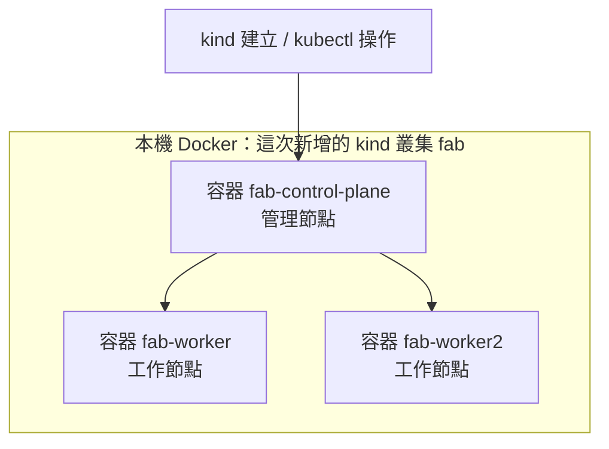
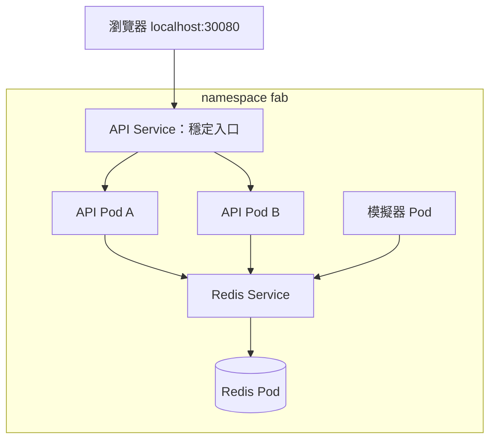

# Lab 02：Kubernetes 基礎（D3–D4：叢集、部署與副本）

## 1. 目標

- 分清楚 Docker、kind、Kubernetes 與 kubectl 的工作。
- 建立一個 control-plane、兩個 worker 的本機叢集，確認三個節點 Ready。
- 用 Deployment 與 Service 部署應用，觀察副本數、Pod 補回與穩定入口。

本 Lab 包含已完成的 D3 建叢集與接續的 D4 部署、scale、自我修復。若已有三個 Ready 節點，直接從步驟 5 開始，不必重建叢集。D5 的滾動更新、回滾與 Redis readiness 故障操作留到下一份 Lab，Phase 2 尚未全部完成。

## 2. 架構圖



這三個是「節點」，不是原本的三個應用服務。節點可以執行多個 Pod；本專案後續會讓每個應用 Pod 執行一個服務容器。管理節點執行叢集管理元件，工作節點承載應用。

D4 新增的應用關係：



圖中箭頭代表請求／連線關係。Service 定義穩定入口與選擇條件，由 Kubernetes 更新可用端點，再由節點網路依 kube-proxy 設定的規則轉送；Deployment 則維持 Pod 數量，不在每筆 HTTP 請求的轉送路徑上。

## 3. 步驟

全程在 WSL 的專案根目錄操作。Docker Desktop 應已啟動，且已開啟此 WSL 發行版的整合。

### 步驟 1：確認工具與釋放舊練習資源

```bash
kind version
kubectl version --client
docker version
```

**指令與預期**：前兩條確認工具，第三條確認 Docker Client 與 Server 都能回應。這次依使用者已安裝的 kind v0.33.0、kubectl v1.34.1，固定 Kubernetes 節點為 v1.34.11；不同 patch 版本不代表不相容。

完成 Docker Lab 後，建議先關閉 Compose，以減少同時占用資源：

```bash
make down
```

**你應該看到**：原本的三個應用容器與 Compose 網路被移除，localhost:8080 看板暫時無法使用；已建好的 image 保留。

**剛剛發生了什麼**：Compose 和 kind 是兩組不同的練習環境。這裡關閉舊環境，接下來建立供 Kubernetes 使用的節點；不會自動把原本三個服務搬進叢集。

### 步驟 2：閱讀設定

```bash
cat deploy/kind/kind-config.yaml
make help
```

**你應該看到**：設定有三個 nodes：一個 control-plane、兩個 worker；help 新增 cluster 和 cluster-down。

**剛剛發生了什麼**：kind 會依這份 YAML 建立節點容器。三個節點使用相同且固定 digest 的 image；extraPortMappings 預留主機 30080 到管理節點 30080，供後續 NodePort 使用，此刻不會提供機台網頁。這也不是 kubectl 使用的管理 API 埠。

### 步驟 3：建立叢集

```bash
make cluster
```

這個 target 依序執行：

```bash
kind create cluster --name fab --config deploy/kind/kind-config.yaml --wait 180s
kubectl --context kind-fab wait --for=condition=Ready nodes --all --timeout=180s
kubectl --context kind-fab get nodes -o wide
```

| 部分 | 用途 |
| --- | --- |
| kind create cluster | 在 Docker 中建立叢集節點 |
| --name fab | 指定練習叢集名稱，建立的 context 為 kind-fab |
| --config | 讀取三節點與埠對應設定 |
| --wait 180s | 等管理平面就緒，逾時回報錯誤 |
| kubectl wait | 再等待所有節點 Ready，而不是只看到容器已啟動 |
| --context kind-fab | 明確指定操作這個練習叢集 |
| get nodes -o wide | 列出節點、狀態、IP 與版本資訊 |

**你應該看到**：下載節點 image、建立節點、準備管理平面、加入 worker 等進度。第一次下載通常較久；成功後列出三個節點，STATUS 都為 Ready，VERSION 為 v1.34.11。

```text
NAME                STATUS   ROLES           VERSION
fab-control-plane   Ready    control-plane   v1.34.11
fab-worker          Ready    <none>          v1.34.11
fab-worker2         Ready    <none>          v1.34.11
```

**剛剛發生了什麼**：kind 初始化 Kubernetes 並把連線設定寫入 WSL 的 kubeconfig，預設位置是 ~/.kube/config，若設定 KUBECONFIG 則使用其指定位置。kubectl 使用這份設定連線管理 API；worker 的 ROLES 顯示 <none> 只代表沒有該欄位使用的角色標籤，不代表它沒有加入叢集。

### 步驟 4：確認自己操作的環境

```bash
kubectl config current-context
kubectl --context kind-fab get nodes -o wide
docker ps --filter label=io.x-k8s.kind.cluster=fab
```

**指令與預期**：第一條查看目前預設 context，剛建完通常是 kind-fab；第二條明確查詢 fab 的三個 Ready 節點；第三條從 Docker 角度查看相同的三個節點容器。

**剛剛發生了什麼**：同一個練習環境可以從兩個角度看：Docker 看見容器，Kubernetes 看見節點。Ready 表示節點可供 Kubernetes 使用，不代表機台監控應用已經部署。到這一步還沒有 fab 應用 namespace，因此還不會看到應用 Pod 或 localhost:30080 看板。

### 步驟 5：建置並載入應用映像

```bash
make build VERSION=v1
make load VERSION=v1
```

**指令與預期**：build 使用已有 Dockerfile 建置兩個 v1 映像，可沿用快取；load 取得固定版本 Redis image，把三個 image 以 linux/amd64 平台匯出到 .cache/kind-images.tar，再匯入 kind 節點。匯出可能暫時沒有進度訊息，匯入階段應看到節點處理進度。

**剛剛發生了什麼**：主機 Docker 的 image 庫與 kind 節點內 containerd 的 image 庫不同；主機有 image，不代表 Kubernetes 節點也有。先匯入、搭配 IfNotPresent，節點就能使用這些本機映像。這一版 deploy/k8s 固定初始 v1，請 build、load 都用 v1；版本更新留到 D5。

load 的核心指令是：

```bash
docker image save --platform linux/amd64 --output .cache/kind-images.tar fab/tool-api:v1 fab/tool-simulator:v1 redis:7.4.2-alpine
kind load image-archive .cache/kind-images.tar --name fab
```

**參數與原因**：save 將已存在的映像封裝成 tar，不是重新 build；--platform 只選節點需要的 Linux AMD64 內容，--output 指定封裝檔位置。image-archive 再把這份完整平台內容匯入 fab 叢集；封裝檔放在已排除 Git 與 Docker build context 的 .cache 目錄。

這採用 kind 官方針對 containerd image store 匯入相容問題的單平台封裝方式，避免 kind load docker-image 匯入全部平台時遇到 content digest not found。Docker image save 的 --platform 需要 API 1.48 或以上；若出現 unknown flag，先提供 docker version 再判斷工具相容性，不要重建叢集。不同 CPU 架構需先確認節點平台後調整 IMAGE_PLATFORM，本次已確認為 linux/amd64。

### 步驟 6：閱讀並套用 Kubernetes 資源

```bash
kubectl kustomize deploy/k8s
```

**指令與預期**：只在本機渲染 Kustomize 組合結果，不連叢集、不部署。應看到 namespace、ConfigMap、三個 Service 與三個 Deployment。

| 設定檔 | 作用 |
| --- | --- |
| namespace.yaml | 建立 fab，把應用和 kube-system 分開 |
| configmap.yaml | 提供 REDIS_URL 與 CHAOS_ENABLED |
| redis.yaml | 一個 Redis Pod 與穩定的 redis Service 名稱 |
| tool-simulator.yaml | 一個模擬器 Pod 與 metrics Service |
| tool-api.yaml | 兩個 API Pod、探針、Pod 身分與 NodePort 入口 |
| kustomization.yaml | 組合以上檔案，統一 namespace |

```bash
make deploy
```

**你應該看到**：kubectl apply 建立資源，接著等待三個 Deployment 就緒。第一次執行會出現 created；同設定再套用可能是 unchanged，或需要更新的部分顯示 configured。

**剛剛發生了什麼**：apply 把期望狀態送給 API Server；控制器建立所需 Pod，scheduler 選擇節點，節點啟動容器。Kubernetes 沒有使用 Compose 的 depends_on；API 的 readiness 檢查 Redis，而模擬器遇到 Redis 尚未可用會重試。

預設共四個應用 Pod：Redis 1、simulator 1、API 2，不是四個 Node。這四個 Pod 的記憶體 requests 合計 192 MiB、limits 合計 768 MiB，不含叢集系統元件與 Docker Desktop。

### 步驟 7：查看 Pod、Deployment 與 Service，開啟看板

```bash
make status
```

**指令與預期**：依序列出 fab 的 Pod（含 NODE）、Service、Deployment。API 應有兩個不同名稱的 Pod，READY 1/1；Deployment 的 READY 為 2/2。拓撲分散規則會盡量讓兩個 API 放到不同 worker，但資源或排程條件仍可能影響結果。

開啟 <http://localhost:30080>，並執行：

```bash
curl -i http://localhost:30080/ready
curl -s http://localhost:30080/api/whoami
```

**你應該看到**：ready 回 200；whoami 回真實 Pod 名稱、Node 名稱與 v1。網頁看到 12 台機台，Pod 色條逐漸出現不同 API 名稱；請求分配次數不保證完全相等。

**剛剛發生了什麼**：流量從主機 30080 進到 kind 節點的 NodePort，再送往可用 API Pod 的 8080。Downward API 把 Pod 與 Node 名稱放進環境變數，程式不用自己向 Kubernetes 管理 API 查詢。本地教學設定讓 uvicorn 不保留 HTTP keep-alive 空閒連線，避免瀏覽器短輪詢長期固定在同一份 Pod，便於看見分流；正式服務需重新評估連線成本。

注意：NodePort 服務層沒有可用端點時，主機入口不一定回應用程式的 503，也可能連線失敗。/ready 的 503 是程式本身回應的狀態碼，兩者不能混為一談。

### 步驟 8：開另一個終端機觀察變化

```bash
make watch
```

**指令與預期**：持續顯示 fab 的 Pod 名稱、狀態、IP 與所在節點。它會一直等候變化，不是卡住；接下來在另一個位於同一專案目錄的 WSL 終端機操作。Ctrl+C 只離開觀察，不會停止 Pod。

**剛剛發生了什麼**：這是 kubectl get pods -o wide -w，持續接收資源更新，讓你能把控制器動作與網頁上的 Pod 身分一起看。

### 步驟 9：把 API 副本數調到三個

```bash
make scale N=3
make status
```

**你應該看到**：API Deployment 目標改成 3，出現第三個 API Pod；就緒後網頁最近 30 次 Pod 回應逐漸出現三個名稱／顏色。三個 API Pod 仍使用既有兩個 worker，不會因此建立三個新節點。

**剛剛發生了什麼**：scale 修改叢集中 Deployment 的期望副本數，由控制器補足 Pod。這不是一個主服務加三份備份，而是總共三個可運作的 API 副本。

檔案中的 replicas 仍是 2；若再次 make deploy，宣告設定會把期望數調回 2。想恢復兩個副本也可明確執行 make scale N=2。程式未修改，不需要為了 scale 重新 build image。

### 步驟 10：刪除一個 API Pod，觀察補回

保持 watch 和網頁開著：

```bash
make kill-pod
```

**指令與預期**：這個 WSL/Bash target 查詢 kind-fab/fab 裡 app=tool-api 的 Running Pod，隨機選一個刪除；找不到時回報錯誤，不會刪除節點。watch 會看到舊 Pod 結束、新 Pod 建立並 Ready，最後回到設定的副本數。

**剛剛發生了什麼**：刪除 Pod 改變實際狀態，但 Deployment 目標仍在，控制器會建立替代者。新 Pod 有新名稱、可能有新 IP；Service 保留穩定入口、更新可用端點，因此瀏覽器網址不用修改。這不是從備份恢復舊 Pod 記憶體，也不保證補回在瞬間完成。

### 步驟 11：選用 k9s 觀察資源

建議另裝 k9s 作為終端機版叢集檢視工具；可從 [官方 v0.51.0 release](https://github.com/derailed/k9s/releases/tag/v0.51.0) 選 WSL 對應的 Linux 架構套件，依官方安裝說明安裝。此版本作為固定參考，這個專案的部署不依賴 k9s。

```bash
k9s version
k9s --context kind-fab -n fab --readonly
```

**指令與預期**：第一條確認版本，第二條進入 fab 的唯讀檢視。可看到 Pod 即時變化；這與 kubectl 操作的是同一個叢集。

基本操作：輸入 :pods 查看 Pod，:deploy 查看 Deployment，:svc 查看 Service；選取 Pod 後按 l 看 log、d 看描述，? 看快捷鍵，:q 離開。先用唯讀模式避免誤改資源。

### 步驟 12：需要清理時再刪除叢集

後續教學還會使用這個叢集，可以先保留。確定這次不繼續練習時再執行：

```bash
make cluster-down
```

**你應該看到**：kind 刪除名為 fab 的叢集；kind get clusters 不再列出 fab。

**剛剛發生了什麼**：這會移除這個練習叢集的節點與其中所有工作負載，不能只當成暫停；原始碼、Compose 設定與已建的應用 image 不會被刪除。之後用 make cluster 重新建立的是新叢集。

## 4. 自己動手改

1. 自行把 YAML 裡的 API 期望副本數改成 4，再套用；和只執行 make scale 的結果比較，解釋哪個修改會留在 Git 管理的檔案中。
2. 刪除 API Pod 前後，記錄 Pod 名稱／IP 和 Service 的入口，自己用輸出證明「後端可以換，入口可以保持」。

## 5. 面試自問

1. Docker、kind、Kubernetes、kubectl 各自負責什麼？
2. Node、Pod、Deployment、Service 分別解決什麼問題？
3. 為什麼主機 build 完 image，仍需要把它 load 進 kind？
4. 刪除一個 Pod 與修改 Deployment replicas，有什麼差別？
5. Pod 名稱和 IP 改變後，使用者為什麼能繼續使用相同 Service 入口？

## 6. 常見錯誤排查

### 同名叢集已存在，或節點一直 NotReady

先執行 kind get clusters，並用 kubectl --context kind-fab get nodes 確認現有叢集是否可用。若正常就直接沿用；若有 NotReady，查 kube-system 的 Pod、describe node 與 Docker 可用資源。可用 kind export logs --name fab ./kind-logs 匯出診斷資訊。重建前先確認可刪除其中所有工作負載，才 make cluster-down、make cluster。

### 映像載入失敗、ImagePullBackOff 或 ErrImagePull

若 make load 出現 ctr: content digest sha256:...: not found，且命令包含 images import --all-platforms，這和 kind 官方記錄的 containerd image store 問題一致。使用目前 Makefile 的單平台 save／image-archive 流程重跑 make load VERSION=v1，先保留既有叢集；只在載入成功後才進行 deploy。這不是 Python API 程式執行時的錯誤。

先用 kubectl --context kind-fab -n fab describe pod Pod名稱 查看 Events，確認失敗的 image 名稱。初始部署固定 v1，應先 make build VERSION=v1、make load VERSION=v1；確認載入的是 fab 叢集。Redis 的主機下載失敗則查 Docker Desktop 的網路或代理，不要改 Python 程式處理 registry 連線問題。

### 30080 看不到網頁，或 API 一直 0/1

先 make status，分開看 Pod 是否 Running、是否 Ready、Service 是否有 NodePort。用 kubectl --context kind-fab -n fab logs deployment/tool-api 和 logs deployment/redis 檢查程式，再用 describe pod 看 readiness 失敗原因。若 Pod 正常，檢查 kind 設定是否有 30080 映射，以及主機埠是否衝突；不要把容器 8080、Service 8080、主機 30080 混為同一層。

參考：[kind 設定與 NodePort 對應](https://kind.sigs.k8s.io/docs/user/configuration/)、[kind 建立叢集](https://kind.sigs.k8s.io/docs/user/quick-start/)、[kind v0.33.0 節點映像](https://github.com/kubernetes-sigs/kind/releases/tag/v0.33.0)、[kind 映像載入已知問題](https://kind.sigs.k8s.io/docs/user/known-issues/#unable-to-kind-load-docker-images)、[Docker 單平台 save](https://docs.docker.com/reference/cli/docker/image/save/)、[Deployment](https://kubernetes.io/docs/concepts/workloads/controllers/deployment/)、[Service](https://kubernetes.io/docs/concepts/services-networking/service/)、[Downward API](https://kubernetes.io/docs/tasks/inject-data-application/environment-variable-expose-pod-information/)、[Uvicorn 連線設定](https://uvicorn.dev/settings/)、[k9s 指令](https://k9scli.io/topics/commands/)。

## 本次操作紀錄（2026-10-25）

- 使用者提供三個節點 Ready、版本 v1.34.11 的輸出。
- 原先 load 遇到 content digest not found，改用單平台封裝匯入後，使用者回報成功。
- 部署輸出：Redis 與 simulator 各一個 Ready Pod，API 兩個 Ready Pod、分散於兩個 worker；localhost:30080/ready 回 200。
- 使用者回報已操作 scale 到三份、kill-pod 及還原兩份；最終貼出的 API Deployment 狀態為 2/2。
- D4 內容已操作；滾動更新、回滾與進一步探針實驗留到 D5。
