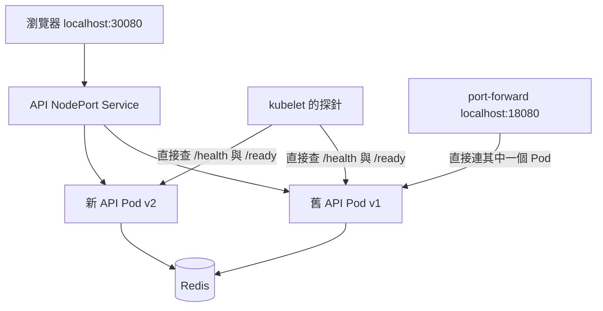

# Lab 03：滾動更新、回滾與健康探針（D5）

## 1. 目標

- 用 v1→v2 的更新與回滾，觀察新舊 API Pod 如何逐步替換。
- 分辨 image、APP_VERSION 與 Deployment revision，理解回滾的是 Pod template。
- 用 Redis 故障驗證 liveness／readiness，並看見 Pod 可執行但不接 Service 流量的狀態。

沿用 D4 的 kind-fab 三節點叢集與 fab 應用。所有命令在 WSL 專案根目錄執行；本 Lab 完成後停在 Phase 2，不安裝監控或執行 CI/CD。

make rollout 需要本機 Python 3.12 執行標準函式庫工具。可沿用前面啟用的虛擬環境；若目前沒有 python 命令，使用 make rollout V=v2 PYTHON=python3.12，不需要為這個工具另外安裝套件。

## 2. 架構圖



新舊版本同時出現，是更新期間的過渡狀態。探針檢查 Pod，Service 的一般流量只選可用端點；因此所有 API 都未 Ready 時，從 Service 入口未必能取得應用程式的 HTTP 503。

## 3. 步驟

### 步驟 1：確認基準並套用 D5 的收尾設定

```bash
make status
kubectl --context kind-fab get nodes
```

**指令與預期**：確認叢集仍在、節點 Ready、應用可運作。若只有 Docker Desktop 剛重新啟動，先等既有叢集恢復，沒有必要為每次練習刪除重建。

```bash
make deploy
```

**你應該看到**：API Pod 可能更新一次，最後回到檔案宣告的 v1、兩個 API 副本。開啟 http://localhost:30080，確認機台資料可更新；本次實驗保持 chaos 未注入。

**剛剛發生了什麼**：這次套用新的 minReadySeconds、preStop 與 terminationGracePeriodSeconds，先建立穩定的 v1 基準。此命令按照 Git 管理的 YAML 恢復 v1／replicas 2；不是保留你上次用 imperative 指令改過的副本或版本。

API 設定中的幾個關鍵值：

| 設定 | 本專案數值 | 原因 |
| --- | --- | --- |
| maxUnavailable | 0 | 更新時不主動把可用副本降到期望數以下 |
| maxSurge | 1 | 允許先多建立一份副本，再逐步退掉舊版 |
| minReadySeconds | 5 | 新 Pod Ready 後先穩定五秒才算 Available |
| preStop | 等待 5 秒 | 讓終止端點的更新有時間傳播，再停止 uvicorn |
| terminationGracePeriodSeconds | 30 | 包含 preStop 與服務收尾的時間預算 |

Terminating Pod 仍可能暫時出現在列表並占用資源，不能把 maxSurge=1 解讀成列表永遠最多只有三行 API Pod。這些設定降低本機更新時的流量中斷機會，仍應以實際請求驗證結果。

### 步驟 2：觀察 Pod 與連續請求

在終端機 B 執行：

```bash
make watch
```

**指令與預期**：持續觀察 Pod 名稱、Ready、狀態與節點，不會自動退出。Ctrl+C 只離開觀察。

在終端機 C 執行：

```bash
while true; do
  curl --silent --show-error --max-time 3 --output /dev/null --write-out '%{http_code}\n' http://localhost:30080/api/tools
  sleep 1
done
```

**指令與預期**：每秒查一次機台 API，略過 JSON 內容、只印狀態碼；max-time 限制單次等待三秒，Ctrl+C 停止。正常時持續看到 200；500、503、000 或 curl 連線錯誤都需要記錄，不能直接當驗收成功。

**剛剛發生了什麼**：這是本機實驗的連續抽樣，讓你同時看見控制器動作與使用者請求。網頁最近 30 次請求面板也要觀察；清空頁面歷史後再開始較容易辨認這次的結果。

### 步驟 3：把 API 從 v1 更新成 v2

回終端機 A 執行：

```bash
make rollout V=v2
```

**你應該看到**：先 build／load v2，然後修改 API Deployment 並等待完成。watch 裡新舊 Pod 逐步交替；網頁右上版本在過渡期間可能收到 v1 或 v2，最後新請求全是 v2。連續抽樣請求應維持 200。

**剛剛發生了什麼**：tools/rollout.py 依序呼叫既有 build、單平台 archive load，再用同一次 strategic merge patch 更新 API 容器的 image 和 APP_VERSION。這是一次 Pod template 修改，避免把 set image 和 set env 分開而觸發兩次更新；既有 POD_NAME、NODE_NAME、探針與其他環境設定會保留。

此實驗的 v2 使用同一份業務程式，主要改 tag 與回傳版本來觀察部署流程。建置／載入 v2 不代表所有服務一起升級；本次只更新 API，模擬器仍使用原本的 v1。

查看實際 image、環境版本與歷史：

```bash
kubectl --context kind-fab -n fab get deployment tool-api -o yaml
kubectl --context kind-fab -n fab rollout history deployment/tool-api
curl -s http://localhost:30080/api/whoami
```

**指令與預期**：Deployment 裡 API image 應為 fab/tool-api:v2，APP_VERSION 為 v2；history 多出 Pod template revision；whoami 顯示 v2 與新 Pod 名稱。完成更新後，網頁最近 30 次記錄仍可能暫留舊 Pod，不代表舊 Pod 還在處理新請求。

### 步驟 4：回滾到前一份 Pod template

```bash
make rollback
```

**你應該看到**：執行 kubectl rollout undo，再等待更新完成。依本 Lab 從 v1 升 v2 的順序，image 與 APP_VERSION 都會一起回 v1；新請求顯示 v1，連續抽樣維持 200。

**剛剛發生了什麼**：undo 回到前一份 Pod template，不是把被刪除的舊 Pod 復活。image 與版本環境變數在同一次修改裡，所以能一起還原；它不會還原 Redis 資料，也不會替你撤銷檔案裡的程式修改。前一版不一定永遠是 v1，多次更新後先看 rollout history。

確認回滾後停止終端機 C 的 curl 迴圈，下一步改用它做 port-forward。先保留終端機 B 的 watch。

### 步驟 5：查看 ConfigMap 與環境變數

```bash
kubectl --context kind-fab -n fab get configmap fab-config -o yaml
kubectl --context kind-fab -n fab exec deployment/tool-api -- printenv REDIS_URL CHAOS_ENABLED POD_NAME NODE_NAME APP_VERSION
```

**指令與預期**：第一條讀取 REDIS_URL、CHAOS_ENABLED 設定；第二條進入其中一個 API Pod，查看程序環境。Pod 名稱與節點由 Downward API 注入，APP_VERSION 此時應為 v1。

**剛剛發生了什麼**：ConfigMap 把設定和程式碼分開；這裡透過 envFrom 注入，環境變數在容器啟動時取得。修改 ConfigMap 並不會自動更新既有程序的 env，需要重新建立／更新 Pod 才會載入；目前只查看，不改依賴位址。

### 步驟 6：直接連一個 Pod，建立探針對照

在終端機 C 執行：

```bash
kubectl --context kind-fab -n fab port-forward deployment/tool-api 18080:8080
```

**指令與預期**：選取一個 API Pod，把本機 18080 轉送到它的 8080，顯示 Forwarding 後持續執行。它不是建立另一個 API，也不是改 Service；若 18080 已占用，選另一個未使用的主機埠並同步修改下方 curl 網址。

回終端機 A 檢查：

```bash
curl -i http://localhost:18080/health
curl -i http://localhost:18080/ready
```

**你應該看到**：兩者都回 200。此時 30080 是正常使用者經過 Service 的入口，18080 則是為了實驗直接連單一 Pod 的診斷入口。

**剛剛發生了什麼**：port-forward 繞過 Service 的一般端點篩選。稍後 API 不 Ready 時，這個仍活著的 Pod 還是能透過直接入口回答，讓你分別看到 200 和 503。練習期間保持該 Pod 不被其他 rollout 或 kill-pod 替換。

### 步驟 7：把 Redis 目標數量降到零

```bash
make break-redis
```

**指令與預期**：修改 Redis Deployment 的 replicas 為 0，Redis Pod 結束。等待數秒及 readiness 的失敗門檻後，API 可能仍是 Running，但 READY 變 0/1，Deployment 顯示 0/2；API 容器 RESTARTS 應沒有因 Redis 故障而增加。

```bash
curl -i http://localhost:18080/health
curl -i http://localhost:18080/ready
kubectl --context kind-fab -n fab get endpointslices -l kubernetes.io/service-name=tool-api -o yaml
```

**你應該看到**：直接 Pod 的 health 為 200、ready 為 503；EndpointSlice 裡 API 端點的 conditions.ready 變 false，一般 Service 流量不再選它們。端點物件或位址仍可能列在 YAML 裡，不代表仍能接一般流量。

**剛剛發生了什麼**：kubelet 的 readiness probe 直接查 /ready，失敗後影響 Pod 的 Ready 條件與 Service 可用端點；liveness 查 /health 仍成功，因此不重啟 API。Redis 也不會自動補回，因為這次已把它的期望數改成零。

此時瀏覽器的 30080 入口失去所有可用 API 端點，可能連線失敗，不能要求一定收到 HTTP 503。這與 Docker Compose 階段直接映射到 API 的行為不同；503 要用本次的 18080 直接 Pod 入口確認。

### 步驟 8：恢復 Redis 與 API 可用性

```bash
make fix-redis
make status
curl -i http://localhost:30080/ready
```

**你應該看到**：Redis 重新建立一個 Pod；API 不用重新 build 或重啟，readiness 逐步恢復，最後回 2/2，30080/ready 回 200，網頁自動恢復資料更新。

**剛剛發生了什麼**：fix 把 Redis 目標改回 1 並等待 Redis、API 可用。Redis 沒有持久化，模擬器仍活著時會把它記憶體裡的目前機台狀態重新寫回，這不是備份還原。完成後在終端機 C 用 Ctrl+C 停止 port-forward，正常使用者入口仍是 30080。

## 4. 自己動手改

1. 自行設計一個新 Pod 一直無法 Ready 的情境，觀察 maxUnavailable: 0 時舊版是否仍能服務，並練習從 Events 找原因與回滾。不要透過刪除整個 namespace 取代排錯。
2. 修改 ConfigMap 的 CHAOS_ENABLED，驗證既有 Pod 的環境變數會不會立即改變；自行找出如何讓 Pod 重新載入，再恢復原設定。

## 5. 面試自問

1. maxUnavailable、maxSurge、minReadySeconds 分別控制什麼？
2. 為什麼 image 和 APP_VERSION 要在同一次 Pod template 修改裡更新？
3. rollout undo 還原哪些東西，不會還原哪些東西？
4. Redis 故障時，為什麼 API 可能 Running 但不 Ready，而且不應被 liveness 重啟？
5. 所有 API 都不 Ready 時，為什麼 Service 入口與 port-forward 的結果可能不同？

## 6. 常見錯誤排查

### 新 Pod Pending、ImagePullBackOff，或 rollout 等待逾時

先 make status，再用 kubectl --context kind-fab -n fab describe pod Pod名稱 看 Events。檢查節點資源、image tag、單平台載入是否成功；build／load 失敗時工具不會繼續 patch。已 patch 卻無法完成時，先查目前還有哪些舊 Pod 可用，再依 history 決定 rollback，不要直接刪掉可用舊 Pod。

### 版本顯示不一致，或 rollback 後不是預期版本

先分辨是網頁最近 30 次的歷史，還是新 whoami 回應。查 Deployment 的 image、APP_VERSION 與 rollout history；undo 回的是前一份模板，不固定指向 v1。make deploy 會依檔案回到 v1／兩份副本，與 undo 的意義不同。

### Redis 停止後，30080 不是 503，或 port-forward 中斷

先區分 Service 入口和直接 Pod 入口：用 EndpointSlice 檢查可用端點，用 18080 直接查 health／ready。port-forward 選到的 Pod 若被更新替換，連線會結束，需重新執行；若 API 持續重啟，查 describe pod 的事件和 logs，不能只依 Running 這一欄判定健康。

參考：[Deployment 更新與回滾](https://kubernetes.io/docs/concepts/workloads/controllers/deployment/)、[kubectl strategic patch](https://kubernetes.io/docs/reference/kubectl/generated/kubectl_patch/)、[健康探針](https://kubernetes.io/docs/tasks/configure-pod-container/configure-liveness-readiness-startup-probes/)、[Pod 終止流程](https://kubernetes.io/docs/concepts/workloads/pods/pod-lifecycle/#pod-termination-flow)。

## 本次操作紀錄（2026-10-26）

- 更新後的輸出：API Deployment 2/2、兩個新 Pod Ready，whoami 回 v2；使用者表示連續請求觀察一直為 200，未提供逐筆紀錄，這裡只記錄本次觀察未見 HTTP 失敗。
- rollback 顯示 successfully rolled out，whoami 回 v1；等待舊副本終止是正常更新過程。
- 直接 Pod 的正常基準：18080/health 與 18080/ready 均為 200。
- Redis 期望數降到零後：18080/health 為 200，18080/ready 為 503，內容 Redis unavailable。
- fix-redis 後，Redis 與 API 的 rollout status 均成功；30080/ready 回 200。
- ConfigMap 輸出確認 REDIS_URL 為 redis://redis:6379/0、CHAOS_ENABLED 為 true；Pod 的 printenv 回應與這兩個設定一致，並顯示實際 Pod／Node 名稱與 APP_VERSION=v1。
- 主要操作與設定來源核對已完成，D5／Phase 2 收尾；尚未開始 Phase 3。
