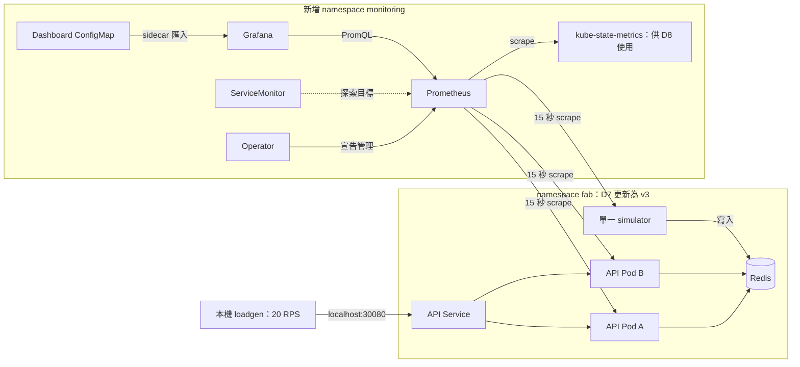

# Lab 04：監控、告警與資料新鮮度（Phase 3）

## 1. 目標

- 理解應用 metrics、Prometheus 抓取與儲存、Grafana 查詢與呈現的分工。
- 使用固定速率壓測，觀察流量、錯誤、延遲、Pod 分流與短窗 SLI。
- 分開驗證 HTTP 成功與機台資料仍在更新。

D7 的實作與操作驗收已完成，結果見「D7 驗收紀錄」。D8 的演練紀錄見文件末尾「D8 驗收紀錄」。

## 2. 架構圖



箭頭是請求方向。Prometheus 分別抓每個 Pod，不是只抓 NodePort；Grafana 不讀 Redis，ServiceMonitor 不是業務代理。

## 3. 步驟

在 WSL 專案根目錄操作，Docker Desktop 保持啟動。明確指定 kind-fab，不操作另一個 kuberay-dev 叢集。

### 步驟 1：應用基準（已完成）

2026-10-28 使用者確認：fab 仍在、三個節點 Ready／v1.34.11；Redis、simulator 各 1/1、API 2/2 分散在兩個 worker；localhost:30080/ready 回 200；兩個 API 都是 v1。Helm v3.22.0；WSL 記憶體 total 15 GiB、available 約 9.1 GiB。

**剛剛發生了什麼**：先證明基礎應用正常，才容易區分後續監控問題。available 是 WSL 估計，不是 Docker 實際使用量；不需重建叢集。

### 步驟 2：建立獨立 WSL 測試環境

```bash
python3.12 -m venv .cache/venv-wsl
```

**你應該看到**：通常沒有輸出，回到提示字元。使用 .cache 以免混用 Windows .venv/Scripts，且不追蹤進 Git／image。

下一步：

```bash
.cache/venv-wsl/bin/python -m pip install -r requirements-dev.txt
```

**預期**：固定依賴安裝成功，失敗先處理網路／套件問題。

再跑：

```bash
make test PYTHON=.cache/venv-wsl/bin/python
```

**預期**：所有服務、新鮮度、loadgen 與 rollout 測試通過。

**剛剛發生了什麼**：fakeredis 或 Redis I/O 替身讓測試不依賴現有叢集；新測試驗證最舊時間、年齡增加、空／無效資料、Redis 故障、成功寫入 timestamp，以及發送排程、並發與錯誤。程式測試不能取代 Helm／瀏覽器驗收。

### 步驟 3：閱讀監控設定

```bash
cat deploy/monitoring/values.yaml
```

**預期**：中文原因註解、固定版本及每個啟用容器的 requests／limits。停用 node-exporter、kind 管理元件抓取、預設 rules、Alertmanager 與大量預設 dashboard；保留 Operator、Prometheus、Grafana、dashboard sidecar、kube-state-metrics。

**剛剛發生了什麼**：values 是 chart 參數，不是給 kubectl 的資源。kube-state-metrics 供 D8 查 Pod Ready；D7 沒有 ToolDataStale 告警。

Chart 固定 92.14.1，images 固定 Operator／reloader v0.94.2、Prometheus v3.15.1-distroless、Grafana 13.2.4-distroless、sidecar 2.14.1、kube-state-metrics v2.20.0。六個常駐容器 requests 合計約 350m CPU／688 MiB，limits 約 2.2 CPU／1888 MiB；Prometheus init reloader 也有資源設定。這是宣告預算，不是量測，不含應用、兩個叢集與 Docker／WSL。

Prometheus 使用磁碟型 emptyDir，保留六小時／256 MiB 的壓縮歷史上限；WAL 等額外占空間，volume 限 1 GiB。Pod 重建可能失去歷史，不是正式 30 天 SLO 儲存。

### 步驟 4：建置 D7 新版本

```bash
make build VERSION=v3
```

**預期**：兩個 image 建置成功；套件層可沿用快取，程式層重新建置。

**剛剛發生了什麼**：D5 v2 是更新示範，D7 v3 真正加入新指標。新 tag 避免同 tag 重建後既有 Pod 不更新或節點沿用舊 cache；現在尚未修改叢集。

### 步驟 5：匯入 image

```bash
make load-images VERSION=v3
```

**預期**：單平台 archive 成功匯入 fab 節點。

**剛剛發生了什麼**：主機與節點 image 庫不同，沿用前面修正 digest 問題的流程。舊 make load 不帶 S 仍匯入 image；明確傳 S 才跑壓測，內部 rollout 使用無歧義的 load-images。

### 步驟 6：部署 D7 overlay

```bash
make deploy-observability
```

**預期**：兩個服務換成 v3，API 最後 2/2，simulator／Redis 各 1/1。

**剛剛發生了什麼**：deploy/overlays/observability 引用原本 base，只改 image 與 API APP_VERSION；保留副本、探針、Downward API。Simulator 使用 Recreate，資料會暫停更新且記憶體的模擬累計重新開始，不能稱作資料無損。舊 make deploy 仍套用 v1，D7 不要用它取代此 target。

接著核對：

```bash
curl -sS --max-time 5 http://localhost:30080/api/whoami
```

**預期**：version=v3，Kubernetes 本身沒有升級。

再查：

```bash
curl -fsS --max-time 5 http://localhost:30080/metrics | grep '^tool_data_age_seconds '
```

**預期**：小的非負秒數；NaN 表示未知，不能當成 0 秒。

**剛剛發生了什麼**：每次 scrape 從 Redis 讀全部機台 updated_at，取最久年齡，不必先有人打 /api/tools。計算最多等兩秒；空資料、Redis 故障、時間無效時輸出 NaN，其他 HTTP metrics 仍可用。Readiness 沒改，仍只查 Redis 連線。

### 步驟 7：先渲染 Helm

```bash
helm template fab-monitor kube-prometheus-stack --repo https://prometheus-community.github.io/helm-charts --version 92.14.1 --namespace monitoring --kube-version 1.34.11 --values deploy/monitoring/values.yaml > .cache/monitoring-rendered.yaml
```

**預期**：成功、檔案非空；下載、schema 或模板失敗先處理。

**剛剛發生了什麼**：只在本機產生 YAML，不安裝叢集。輸出可能含 Secret，放在不追蹤的 .cache，別貼密碼或提交此檔；成功仍不代表容器可以啟動。

### 步驟 8：安裝監控

```bash
make monitoring
```

**預期**：kind-fab 的 monitoring namespace 建立 fab-monitor release，Helm 顯示 deployed、CRD Established、自訂資源套用完成、Prometheus StatefulSet Ready。首次下載 images 可能需幾分鐘。

**剛剛發生了什麼**：先安裝 Operator／CRD，再建立 ServiceMonitor 與 dashboard ConfigMap。全程指定 context，未建立 D8 規則。

再查：

```bash
kubectl --context kind-fab -n monitoring get pods
```

**預期**：四類監控 Pod 都 Ready；Grafana／Prometheus 有 sidecar，可能顯示 2/2。

### 步驟 9：開啟 Prometheus

```bash
make prometheus
```

**預期**：http://localhost:9090；port-forward 持續執行。Targets 中應有兩個 API、一個 simulator 都 UP，另有 chart 自身目標。介面版本不同可在 Status／Service Discovery 選單尋找。

**剛剛發生了什麼**：只是打開本機入口，不是另建 Prometheus；保持終端機開啟，先查 targets 再解讀數字。

在 Query／Graph 一次查一條：

```promql
up{namespace="fab",job=~"tool-api|tool-simulator"}
```

**預期**：三條序列為 1。

```promql
max(tool_data_age_seconds{namespace="fab",job="tool-api"})
```

**預期**：小的非負秒數。

```promql
time() - max(simulator_last_tick_timestamp_seconds{namespace="fab",job="tool-simulator"} > 0)
```

**預期**：距最後成功寫入的時間；受 15 秒 scrape 影響，可能比兩秒 tick 大。Unix timestamp 與現在相減才是年齡；0 是從未成功寫入。未知／無資料先排錯，不補成健康的零。

### 步驟 10：開啟 Grafana

另一個相同目錄的 WSL 終端機：

```bash
make grafana
```

**預期**：http://localhost:3000、帳號 admin、從 Secret 解出的密碼；密碼留在本機。登入後找「fab-monitor：D7 應用監控」，稍候自動匯入，不必手動貼 JSON。

**剛剛發生了什麼**：sidecar 依 grafana_dashboard=1 載入 ConfigMap；datasource UID prometheus 指向叢集內 Prometheus。Grafana 不直接抓應用 metrics。

### 步驟 11：20 RPS 壓測 60 秒

保持兩個 port-forward，在第三個終端機：

```bash
make load S=60 RPS=20 PYTHON=.cache/venv-wsl/bin/python
```

**預期**：約 60 秒後有 JSON，scheduled=1200，sent 應接近／等於 scheduled，dropped=0、network_errors=0，正常回應為 200。網頁背景輪詢也算流量，Grafana RPS 可能略高；5 分鐘 rate 窗初始有暖機。

**剛剛發生了什麼**：單調時鐘排定發送，不等每個回應再睡眠。最多 100 個在途請求、單次逾時兩秒；追不上時記錄 dropped，避免無限排隊。HTTP 錯誤、網路失敗或發送不足回非零，要讀統計，不能只看程序結束。

略過發送的診斷：drop_reasons 分開記錄 schedule_late（落後至少一個發送間隔）、concurrency_limit（在途請求達上限）、window_ended（已到發送截止時間）；first_drop 只保留第一筆的原因、從 1 起算的 slot、scheduled_offset_ms、lateness_ms 與 in_flight。這些數值幫助定位發送器問題，與 HTTP status_codes／network_errors 分開。退出規則仍保留任何 dropped 即失敗。

正式計時前先以 AnyIO 公開 API 準備 async backend，preparation_seconds 另列這段耗時；沒有額外發送 HTTP 暖機請求。duration_seconds 與 elapsed_seconds 是準備完成後的量測窗（elapsed 也包含等待最後在途請求收尾），不能把準備耗時誤當服務延遲。HTTP client 首次使用時的後端懶初始化可參考 [HTTPCore 固定版本實作](https://github.com/encode/httpcore/blob/1.0.9/httpcore/_backends/auto.py) 與 [AnyIO 固定版本實作](https://github.com/agronholm/anyio/blob/4.9.0/src/anyio/_core/_eventloop.py)。

十個面板包含 code RPS、5xx、p50/p95/p99、各 Pod RPS、可用性 SLI／99% 線、300ms 延遲 SLI／95% 線、5 分鐘示範 budget、機台狀態、資料年齡、最後成功寫入年齡。正常時機台總數 12、年齡低、錯誤比例接近零；分流不保證相等。

SLI 直接查原始 metrics，D8 才建 recording rules。可用性是非 5xx 比例；延遲 SLI 是 300ms 內的比例，不是 p95 本身。短窗 budget 為 `1 - 錯誤比例 / 0.01`，錯誤比例 0／1%／2% 對應 100%／0%／-100%，不是正式 30 天 budget。無流量／不足樣本不能補成 100% 成功。

面試說法：「我讓應用提供 metrics，由 ServiceMonitor 指定 Prometheus 分別抓取每個 Pod，再用 Grafana 看流量、錯誤、延遲與資料年齡。讀到舊資料也可能回 200，因此可用性與資料更新須分開驗證。」

### 步驟 12：停止點

Ctrl+C 只停止各終端機 port-forward，Pod 仍運作。記錄驗收後停止，等使用者確認 D8，不提前 scale simulator 到零或建立告警。

## 4. 自己動手改

1. 改成另一個小 RPS，比較 sent／duration 與 Grafana 五分鐘 RPS，解釋背景流量和暖機。
2. 在 Explore 查某個 API Pod 的 RPS，再與兩個 Pod 加總比較，不為平均分流而刪 Pod。

## 5. 面試自問

1. Prometheus、Grafana、ServiceMonitor 分別負責什麼？為何分別抓每個 Pod？
2. Counter、Gauge、Histogram 差在哪？為什麼 counter 要搭配 rate？
3. p95 與「300ms 內的比例」差在哪？
4. 為什麼 HTTP 200、readiness 通過仍可能有舊資料？
5. 無資料、NaN、RPS=0、資料年齡=0 分別代表什麼？
6. SLI、SLO、SLA 差在哪？99% 的 30 天 error budget 怎麼算？
7. 告警為什麼先 Pending 才 Firing？清除故障後為什麼不會馬上解除？
8. 為什麼資料新鮮度不放進 readiness？
9. 告警消失就代表恢復了嗎？怎麼分辨？

## 6. 常見錯誤排查

### Helm 失敗或監控 Pod 不 Ready

先分辨下載、模板、啟動階段。模板問題停在步驟 7；Pod 問題先 get pods，再 describe／logs。Pending 查排程／requests，OOMKilled 查使用量／limits，不刪另一個叢集或減少 API 掩蓋問題。代理沒有可用 Helm／WSL 存取，完整 render、安裝及 runtime 待使用者驗證，靜態檢查不能替代。

本次實際案例：Helm 等待逾時，Operator 卡在 ContainerCreating；describe 的 Events 顯示 FailedMount，缺少 fab-monitor-admission Secret。原因是 webhook／憑證 Job 已停用，但 Operator 自身 TLS 預設仍開啟。values 已補 prometheusOperator.tls.enabled=false；不是建立假的 Secret，也不是只延長 timeout。修改檔案後仍須重新渲染，確認 Operator 不再掛載 tls-secret／傳入憑證參數，再套用 Helm 驗證。參考 [固定 chart 的 TLS 與憑證設定](https://github.com/prometheus-community/helm-charts/blob/kube-prometheus-stack-92.14.1/charts/kube-prometheus-stack/values.yaml)。Grafana 的 CrashLoopBackOff 是另一個待查問題，不能因修正 Operator 就宣稱整套恢復。

後續 describe 確認 grafana 主容器 Running／Ready、Restart Count=0，失敗的是 grafana-sc-dashboard：Last State=OOMKilled、Exit Code=137，當時 memory limit=96Mi。已把 sidecar request 從 32Mi 改 64Mi、limit 從 96Mi 改 256Mi，待重新渲染／套用後觀察是否持續 Ready。request 是排程依據，不是使用上限；即使 WSL 還有記憶體，容器仍會受自己的 limit 限制。先讀每個容器的狀態，再用 -c 選對容器查 logs；主容器沒有重啟時，logs --previous 會回 not found，不能因此假設沒有其他容器失敗。參考 [Kubernetes 資源限制](https://kubernetes.io/docs/concepts/configuration/manage-resources-containers/)。

第二次案例發生在登入後：grafana 主容器於 22:15:53 OOMKilled（limit=256Mi）、22:15:55 重啟，剛好對應 22:15:54 port-forward 的 Pod 內 3000 connection refused；sidecar 的重啟數仍為零。已只把主容器 request 改 256Mi、limit 改 512Mi，待 make monitoring 套用，再重新 make grafana 並操作 dashboard 驗證。容器被 OOM 終止後，kubelet 依 restartPolicy 重啟；這次 Pod 名稱沒變，readiness 本身沒有觸發重啟。不能只因稍後又 Ready，就忽略 Last State 與重啟次數。

### Targets 缺少或 UP=0

先 `kubectl --context kind-fab -n monitoring get servicemonitor`，再 `kubectl --context kind-fab -n fab get service --show-labels`。核對 release=fab-monitor、Service 的 app 標籤、namespaceSelector=fab、port 名稱 http／metrics，再查 endpoints 與 /metrics。記下 scrape error，不直接改抓 NodePort。

### Grafana 沒圖或沒新指標

先查 up 與原始 metric；API 還是 v1 時確認 v3 build／load 與 overlay 成功，不只重建同 tag 再 apply base。全部沒圖查 datasource；只有 rate 無值時等至少兩次 scrape 並確認有流量；NaN 查 Redis／時間欄位，不補零。

## D7 驗收紀錄

- 2026-10-28：使用者完成重開機後應用、版本、Helm、可用記憶體確認。
- 固定依賴完整 pytest：初次 54 passed；壓測診斷／初始化修正後，使用者以 WSL Python 3.12.3／pytest 8.3.5 回報 57 passed in 12.48s，涵蓋全部服務與工具。
- v3 部署與 metrics：使用者回報兩個服務 rollout 成功，whoami 回 v3；tool_data_age_seconds=1.371187448501587，符合正常更新基準。
- Helm render／安裝：TLS 掛載／sidecar OOM／Grafana main 256Mi OOM 均經修正並套用；release revision 3 deployed，dashboard 已開啟。Grafana main limit=512Mi、sidecar limit=256Mi；使用者操作與壓測後回報 Pod AGE=89m、2/2 Running、重啟數零。
- 三個應用 targets：使用者截圖確認 API 2/2 UP、simulator 1/1 UP。
- PromQL 新鮮度：max(tool_data_age_seconds) 約 0.911857 秒；距 simulator 最後成功寫入約 6.14 秒，均符合正常更新與 scrape 基準。
- 首次壓測：20 RPS／60 秒，scheduled=1200、sent=1199、dropped=1、achieved_send_rps=19.983；1199 筆全為 HTTP 200、network_errors=0、mean_latency_ms=14.93、max_latency_ms=185.22、elapsed_seconds=60.001。loadgen 因 dropped>0 回 exit 1，make 如實回報失敗；本輪 API 成功率與壓測器發送完整度須分開解讀，未達零 dropped 的嚴格發送驗收。
- Grafana 十個面板已驗證。截圖顯示請求量升至約 3–4 RPS、兩個 API Pod 分流、5xx 比例零、histogram 估計 p95 約 20ms；機台狀態與兩個新鮮度面板有曲線。SLI／budget 歷史資料已另以 Prometheus API 核對（下方）。五分鐘 rate 會平滑一分鐘壓測，不直接要求圖上等於 20 RPS。
- 初始化計時修正後的 WSL 回歸：preparation_seconds=0.1、elapsed_seconds=60.001、scheduled=1200、sent=1200、dropped=0（三類均零）、first_drop=null、achieved_send_rps=20.0、HTTP 200 共 1200、network_errors=0、mean_latency_ms=15.155、max_latency_ms=61.215，沒有 make Error。本輪固定速率壓測驗收通過；前幾輪失敗保留供排錯，不再重跑同一壓測。
- SLI／budget 核對：代理對使用者已開啟的本機 Prometheus 唯讀查詢 dashboard 三個相同 PromQL，時間窗三小時、step=15s；各有 578 個時點，91 個有限值的 min=max=1.0，即有效請求時段可用性、延遲 SLI、短窗 budget 剩餘都是 100%。無流量時的未定義值沒有當成成功，99%／95% 目標線亦未誤當實際值。三個查詢均 success、沒有 warnings。
- **D7／Phase 3a 驗收完成，在此停止；D8／Phase 3b 尚未開始，等待使用者明確確認。**

### 安裝修復後的實際結果

- 使用者提供 make monitoring 完整收尾：CRD Established、自訂 dashboard ConfigMap 與兩個 ServiceMonitor created、Prometheus StatefulSet rolling update complete。
- 後續 get pods 確認 Grafana 2/2、Operator 1/1、kube-state-metrics 1/1、Prometheus 2/2，均 Running／RESTARTS=0；新 Pod 已運作約 10–11 分鐘。
- Operator 的憑證掛載阻塞及 dashboard sidecar 的 OOM 重啟目前已解除；targets、PromQL、Grafana 面板與壓測仍須分別驗證，不能只憑 Pod Ready 判定 D7 完成。

首次壓測的 dropped 表示發送器略過預定時槽，不代表 API 回 5xx，也不計入已收到的 HTTP 回應分母。當時工具只合計 dropped，不足以定位原因。第二輪保持相同條件後，仍 scheduled=1200、sent=1199、dropped=1，全部 200、network_errors=0，mean_latency_ms=14.511、max_latency_ms=135.494、elapsed_seconds=60.002。兩輪都保留，不能以 API 全成功宣稱發送器已達標。

為定位漏發，loadgen 已加入 drop_reasons／first_drop，保留原本排程、並發與非零退出規則。新診斷測試先失敗再實作，現有套件環境下 12 項 loadgen 測試通過，Python 3.12 編譯檢查通過；不是使用者固定環境的完整新結果。代理本機 loopback 3 秒／20 RPS 實驗 60/60 成功、沒有重現略過；尚無證據斷定是 WSL 或 HTTP client 冷啟動。下一步用帶診斷的工具取得實際漏發時槽，再依證據修復。

第三輪提供的時序：schedule_late=1、slot=2、scheduled_offset_ms=50、lateness_ms=65.749、in_flight=1，代表第二個時槽在開始後約 115.749ms 才被處理，排除本輪的 concurrency_limit 與 window_ended 分支。第三輪仍 1199 筆全 200、網路錯誤零，平均 15.135ms、最大 132.593ms。此線索支持檢查初次後端準備，但不能只憑位置斷定全部是套件初始化。

已補初始化回歸測試：模擬首次 async backend 準備耗 120ms，原版正式窗只送 3/4、修正後 4/4。loadgen 現先 anyio.sleep(0) 再記錄 start，保留所有發送／失敗規則與診斷；準備耗時獨立回報。工具測試用 Windows Python 3.12.13 與使用者虛擬環境的純 Python 固定依賴（httpx 0.28.1、httpcore 1.0.9、anyio 4.9.0、pytest 8.3.5）執行 21 項通過，獨立審查通過；仍待 WSL 原條件壓測確認，不能宣稱現場已修復。完整測試數預期增加至 57，待使用者收尾驗證。

後續 WSL 原條件回歸已完整送出 1200/1200、零略過、全 200。preparation_seconds=0.1 支持初始化成本超過 50ms 發送間隔的分析；相同嚴格排程與退出規則下，本次將後端準備移到正式窗前後問題解除。這份結果驗證本次修正與負載，不宣稱所有電腦或任意負載都不會再有排程遲到。

參考：[固定 chart](https://github.com/prometheus-community/helm-charts/blob/kube-prometheus-stack-92.14.1/charts/kube-prometheus-stack/Chart.yaml)、[固定 values](https://github.com/prometheus-community/helm-charts/blob/kube-prometheus-stack-92.14.1/charts/kube-prometheus-stack/values.yaml)、[ServiceMonitor](https://prometheus-operator.dev/docs/developer/getting-started/)、[Prometheus 函式](https://prometheus.io/docs/prometheus/latest/querying/functions/)、[Grafana provisioning](https://grafana.com/docs/grafana/latest/administration/provisioning/)。


## D8 驗收紀錄

SLI 的 route 收窄為 `/api/tools.*`，原因見 [docs/slo.md](../slo.md)。規則套用前已用 promtool 檢查，並用模擬資料測試全 5xx、無流量、NaN 等情境；模擬資料不算驗收，以下才是實際結果。

規則：2026-10-31 套用後，Rule health 的 `fab-slo` 群組 6 條規則全部 ok，20 RPS／60 秒壓測 1200 筆全 200。

### 演練 1：ToolApiHighErrorRate

指令：終端機 1 `make load S=600 RPS=20 PYTHON=.cache/venv-wsl/bin/python`；終端機 2 `sleep 60; date +%T; make chaos-errors; sleep 180; date +%T; make chaos-clear`。壓測收到 500 時 make 顯示 Error 1 是預期結果。

| 次數 | 注入 | Pending | Firing | 清除 | 解除 | SLI 最低 | 結論 |
|---|---|---|---|---|---|---|---|
| 第 1 次 | 10:05:02 | 10:05:26 | 10:06:26 | 10:47:13 | 約 10:24 消失 | 79.6% | **假恢復**，不算解除 |
| 第 2 次 | 10:52:41 | 10:53:00 | 約 10:54:00 | 10:55:37 | 未量到 | 86.2% | 10:59 起 Prometheus 中斷，**不算** |
| 第 3 次 | 14:28:00 | 14:28:25 | 約 14:29:25 | 14:30:52 | 14:35:58 | 85.3% | **通過** |

第 3 次解除時流量約 21 RPS、SLI 99.6%，是真的恢復。清除到解除 5 分 06 秒。Firing 時間由 `for: 1m` 推算，輪詢在 14:29:42 觀察到。

**第 1 次的假恢復**：壓測約 10:19 結束時 chaos 還開著。約 5 分鐘後窗內沒有請求，SLI 變 NaN，告警消失，但故障要到 10:47 才清除。告警消失不等於恢復，判斷恢復要確認當時有流量。

**第 2 次的中斷**：Prometheus 在 10:59 到 14:24 沒有資料，SLI 卡在 93.58% 是沿用最後一筆。電腦休眠是推測，沒有直接證據。

**機制**：`for: 1m` 要求條件連續成立 1 分鐘，所以先 Pending 再 Firing，用來過濾抖動。Firing 不用等滿 5 分鐘窗：少量錯誤就足以讓 SLI 跌破 99%。清除後要等舊錯誤滑出窗口，所以恢復比實際晚約 5 分鐘。

### 演練 2：ToolDataStale

指令：`kubectl --context kind-fab -n fab scale deployment/tool-simulator --replicas=0`，排查後 `--replicas=1`。

| 事件 | 時間 |
|---|---|
| Redis 最後一次更新 | 15:41:49 |
| Pending | 15:42:42 |
| Firing | 15:44:42（Pending 後 2 分鐘，符合 `for: 2m`） |
| scale 回 1 | 16:15:15 |
| 資料年齡降回 1.3 秒 | 16:15:37 前（scale 前 2006 秒，約 33 分鐘） |
| 告警解除 | 16:15:37 到 16:15:52 之間（16:15:37 是最後一筆 Firing） |

Firing 期間：`/api/tools/ETCH-01` 回得到資料，`updated_at` 停在 07:41:49（UTC）；可用性 SLI 為 100%、流量約 21 RPS，`ToolApiHighErrorRate` 沒有觸發。

使用者照 runbook 四站排查：deployment `0/0`、沒有 Pod；`logs` 回 `timed out waiting for the condition`；Redis 和 API 的 `updated_at` 相同且都舊。根因是 simulator 被 scale 到 0，**Redis 和 API 本身正常**，只是拿到舊資料。

恢復時壓測已結束（SLI 為 NaN），但新鮮度不靠流量：資料年齡是實際數字 0.3 秒，所以是真的恢復。這條告警看當下年齡，不是 5 分鐘平均，恢復約 30 秒內解除；演練 1 則要等舊錯誤滑出窗口，需要 5 分 06 秒。

**D8／Phase 3b 兩次演練已實際驗收。** `ToolApiSlowResponses`、`ToolApiPodNotReady` 只確認規則載入，沒有演練。
