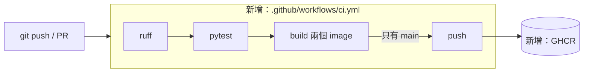

# Lab 05：CI/CD（Phase 4）

## 1. 目標

- 理解 lint、test、build、push 的順序，以及失敗時為什麼後面都不會跑。
- 親眼看到 PR 被失敗的測試擋下，修好後才發佈 image。
- 能說明 SHA tag 和 `GITHUB_TOKEN` 的好處。

## 2. 架構圖



## 3. 步驟

在 WSL 專案根目錄操作。

### 步驟 1：本機先跑一次 lint

```bash
make lint PYTHON=.cache/venv-wsl/bin/python
```

第一次要先裝依賴：`.cache/venv-wsl/bin/python -m pip install -r requirements-dev.txt`。

**你應該看到**：`All checks passed!`

**剛剛發生了什麼**：ruff 用預設規則檢查所有 Python 檔案。CI 跑的是同一個 `make lint`，本機先過就不用等 CI 才發現。

### 步驟 2：閱讀 workflow

```bash
cat .github/workflows/ci.yml
```

**你應該看到**：`lint`、`test`、`build`、`push` 四個 job，用 `needs` 串成順序；頂層 `permissions: contents: read`，只有 `push` 有 `packages: write`。

**剛剛發生了什麼**：`needs` 決定順序，前一個失敗後面就不跑。`if` 限制只有 push 到 `main` 才發佈。

### 步驟 3：看 push 到 main 的 run

開 repo 的 Actions 頁面。

**你應該看到**：四個階段依序變綠，`build` 和 `push` 各有兩個服務。

**剛剛發生了什麼**：`build` 把 image 存成 artifact，`push` 載入同一份推到 GHCR，所以發佈的就是驗證過的內容。

### 步驟 4：故意讓 PR 變紅

開一個 branch，加一個會失敗的測試，發 PR。

**你應該看到**：`lint` 綠、`test` 紅，`build` 和 `push` 是 skipped。

**剛剛發生了什麼**：測試失敗就不會 build，也不會發佈，壞掉的程式進不了 GHCR。

### 步驟 5：修好並 merge

修正測試後 push 同一個 branch。

**你應該看到**：PR 全綠，但 `push` 仍是 skipped。merge 後，`main` 的 run 才會 push。

**剛剛發生了什麼**：PR 只驗證不發佈。merge 後 repo 的 Packages 會出現 short SHA 和 `latest-main` 兩個 tag。

## 4. 自己動手改

1. 在 PR 裡故意寫一個 ruff 會抓到的錯誤（例如沒用到的 import），看 pipeline 停在哪一步。
2. 把 `latest-main` 改成另一個 tag 名稱，解釋 tag 改了之後，舊 tag 會發生什麼事。

## 5. 面試自問

1. 為什麼測試要放在 build 之前？
2. 為什麼 image tag 要用 SHA，不能只用 latest？
3. PR 和 push 到 main，pipeline 有什麼不同？為什麼？
4. `GITHUB_TOKEN` 和存在 repo 的長期金鑰差在哪？和 OIDC 有什麼共通點？
5. 為什麼 Action 要鎖 commit SHA，而不是 `@v7`？

## 6. 常見錯誤排查

### push 回 `denied` 或 403

確認 job 有 `permissions: packages: write`。job 層級的 permissions 會取代頂層設定。Image 名稱也要全小寫，GitHub 帳號有大寫時不能直接用 `github.repository_owner`。

### push 卡住不動

開 job log 看是不是卡在 layer 上傳。Log 要等 job 結束才完整，可以先取消再讀。實際案例見 [docs/cicd.md](../cicd.md)。

### 本機過了，CI 卻失敗

比對 Python 版本和依賴是否相同。CI 用 3.12.12 和 `requirements-dev.txt`，本機如果多裝了套件，可能掩蓋缺少的依賴。

## Phase 4 驗收紀錄

2026-10-31 實際執行：

| Run | 事件 | 結果 |
|---|---|---|
| 41184240700 | push 到 `main`（`afbea11`） | lint、test、build 成功；`push (tool-simulator)` 成功；`push (tool-api)` 卡住，取消 |
| 41184758927 | PR 故意失敗 | lint 成功、test 失敗，build、push skipped |
| 41185099189 | PR 修正後（`c2551d8`） | 全部成功，push skipped |
| 41185217501 | merge 到 `main`（`065f61d`） | 全部成功，約 2 分鐘 |

GHCR 確認：`tool-api` 和 `tool-simulator` 都有 `065f61d`、`latest-main`。

本機 63 passed，`make lint` 通過。`actionlint` 和本機 `docker build` 沒有跑成（環境限制），workflow 與 image build 以 GitHub Actions 的實際執行結果為準。
